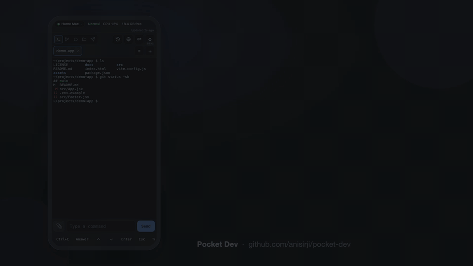
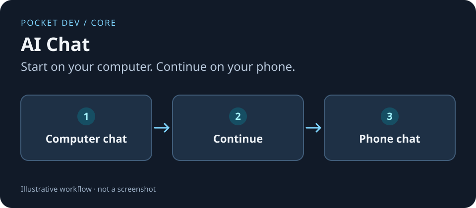
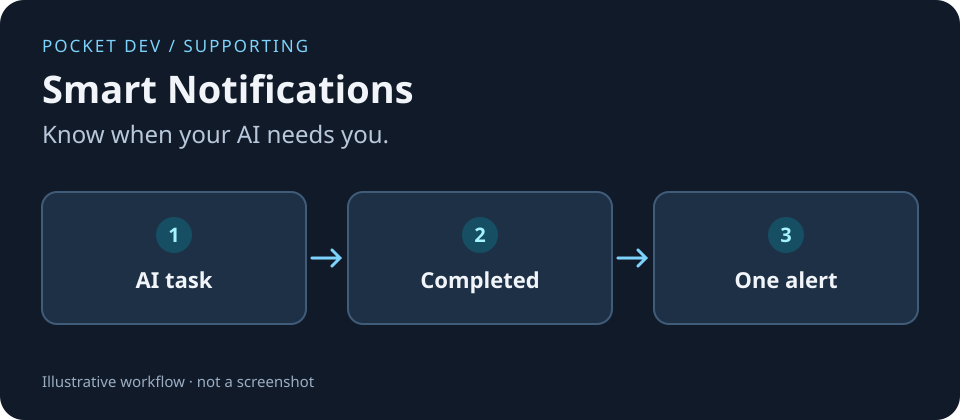
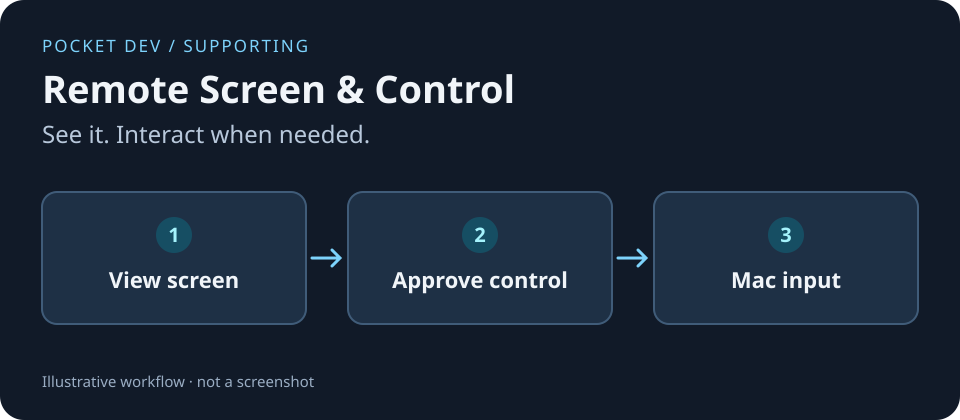
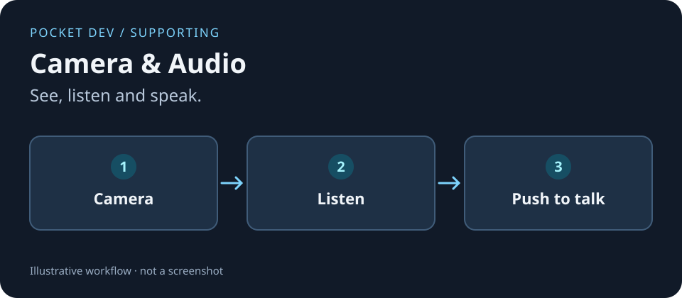
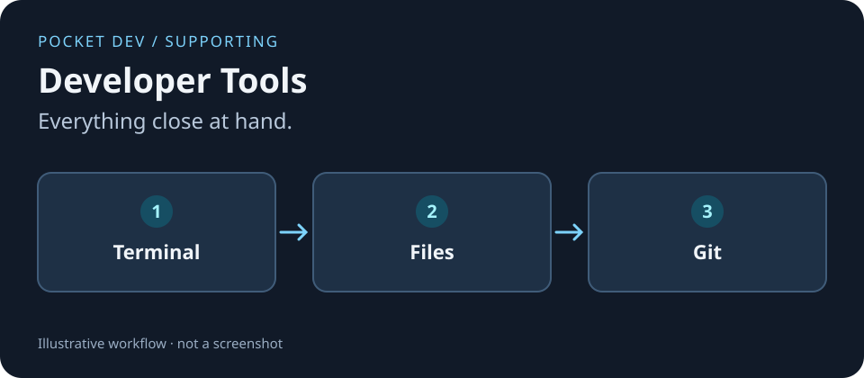
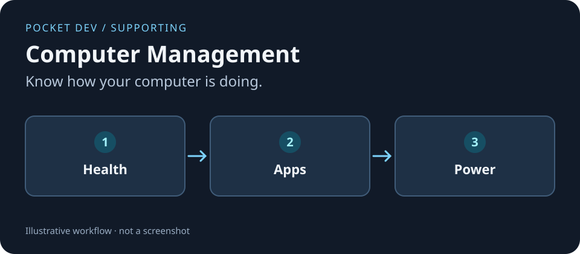
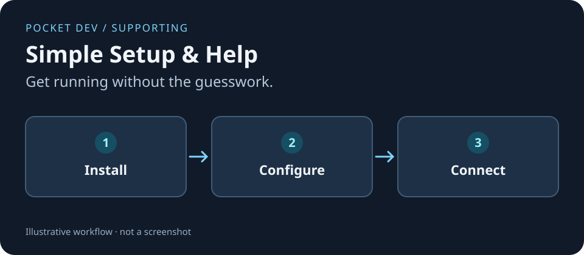

# Pocket Dev

**Your computer. In your pocket.**

Continue AI conversations across devices, connect your team's authorized AI capabilities and develop projects from one browser-based workspace.

For developers and small startup teams. Free and open source (ISC). No mobile app or Pocket cloud account required.

[](https://www.npmjs.com/package/@anisirji/pocket-dev)  [](https://github.com/anisirji/pocket-dev/blob/main/LICENSE)

[Website](https://www.theani.me/work/pocket-dev) · [Features](https://github.com/anisirji/pocket-dev/blob/main/docs/FEATURES.md) · [Setup](https://github.com/anisirji/pocket-dev/blob/main/docs/START_HERE.md) · [YouTube](https://www.youtube.com/@afk_pocket_dev)

> **Version 3 preview:** 3.0.0 is in development and not yet published to npm. Manual validation is pending. The npm badge shows the published version; diagrams illustrate workflows. See [release notes](https://github.com/anisirji/pocket-dev/blob/main/docs/RELEASE_3.0.md).

## Get started

On your computer with [Node.js 22+](https://nodejs.org/):

```bash
npm install -g @anisirji/pocket-dev
pocket-dev start
```

Install → Follow guided setup → Scan the QR code → Start working.

Use the same network initially. Keep your computer awake and connected. Optional tools and permissions can be configured in Admin.

[Windows](https://github.com/anisirji/pocket-dev/blob/main/docs/windows.md) · [macOS](https://github.com/anisirji/pocket-dev/blob/main/docs/macos.md) · [Linux](https://github.com/anisirji/pocket-dev/blob/main/docs/linux.md) · [Set up with AI](https://www.theani.me/work/pocket-dev/prompts)

<p align="center"></p>

## Three reasons to use Pocket Dev

### AI Chat

**Start on your computer. Continue on your phone.**



Continue Claude Code and Codex conversations across devices, switch providers and respond to approvals. [Learn more](https://github.com/anisirji/pocket-dev/blob/main/docs/GUIDE.md#chat-with-claude-code-codex-antigravity-and-copilot).

### AI & Resource Sharing

**One team. More AI capabilities.**


Connect authorized computers and choose a compatible shared AI source while keeping your project on its workspace computer. [Learn more](https://github.com/anisirji/pocket-dev/blob/main/docs/UNIFIED_CONNECTIONS.md).

### Workspace

**Your project. One place.**


Use a VS Code-inspired editor, files, chat, terminal and Git in one workspace. [Learn more](https://github.com/anisirji/pocket-dev/blob/main/docs/GUIDE.md#project-workspace).

## Everything else you need

| | |
| --- | --- |
| **[Smart Notifications](https://github.com/anisirji/pocket-dev/blob/main/docs/FEATURES.md#smart-notifications)**<br><br>Get a short sound and temporary alert when a task completes, fails or needs attention — no notification inbox. | **[Remote Screen & Control](https://github.com/anisirji/pocket-dev/blob/main/docs/FEATURES.md#remote-screen--control)**<br><br>View an authorized computer's screen and choose displays or quality where supported; optional Mac input needs local approval. |
| **[Camera & Audio](https://github.com/anisirji/pocket-dev/blob/main/docs/FEATURES.md#camera--audio)**<br><br>View the host camera, listen to its microphone and use push to talk through its speakers with authorization. | **[Developer Tools](https://github.com/anisirji/pocket-dev/blob/main/docs/FEATURES.md#developer-tools)**<br><br>Use terminals, files, Git, development ports and device-to-device messages. |
| **[Computer Management](https://github.com/anisirji/pocket-dev/blob/main/docs/FEATURES.md#computer-management)**<br><br>See available health information, manage running apps and use supported power controls. | **[Connected & Self-hosted](https://github.com/anisirji/pocket-dev/blob/main/docs/FEATURES.md#connected--self-hosted)**<br><br>Connect locally or enable optional remote access; authorize devices with QR codes and manage permissions. |
| **[Simple Setup & Help](https://github.com/anisirji/pocket-dev/blob/main/docs/FEATURES.md#simple-setup--help)**<br><br>Install with npm, configure through guided Admin setup and use contextual instructions and diagnostics. |  |

## Your computer. Your control.

Pocket runs on your computer with local state, no centralized Pocket database and no required Pocket cloud account. Local access is the default. Optional tunnels, browser push and external AI services may use external infrastructure. Features depend on OS, permissions and installed tools. Share AI only where authorized and permitted by provider terms. [Access and permissions](https://github.com/anisirji/pocket-dev/blob/main/ACCESS.md) · [Sharing limits](https://github.com/anisirji/pocket-dev/blob/main/docs/UNIFIED_CONNECTIONS.md).

## Documentation & support

[Start here](https://github.com/anisirji/pocket-dev/blob/main/docs/START_HERE.md) · [All features](https://github.com/anisirji/pocket-dev/blob/main/docs/FEATURES.md) · [Troubleshooting](https://github.com/anisirji/pocket-dev/blob/main/docs/GUIDE.md#troubleshooting) · [Release notes](https://github.com/anisirji/pocket-dev/blob/main/docs/RELEASE_3.0.md) · [Technical reference](https://github.com/anisirji/pocket-dev/blob/main/docs/REFERENCE.md).

[Report a bug](https://github.com/anisirji/pocket-dev/issues/new/choose) · [Discussions](https://github.com/anisirji/pocket-dev/discussions) · [Instagram](https://www.instagram.com/afk_pocket_dev)

Built by [anisirji](https://theani.me) and contributors, including [Rohit Kumar Das](https://www.linkedin.com/in/rohit-kumar-das-583b28223). ISC License. Preserve the copyright notice when redistributing.

*Spend less time tied to a desk, without losing touch with your work.*
