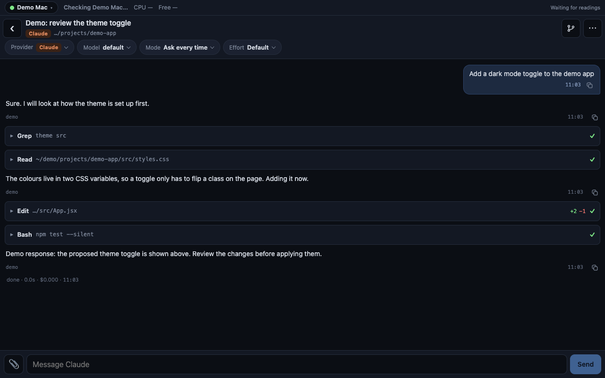
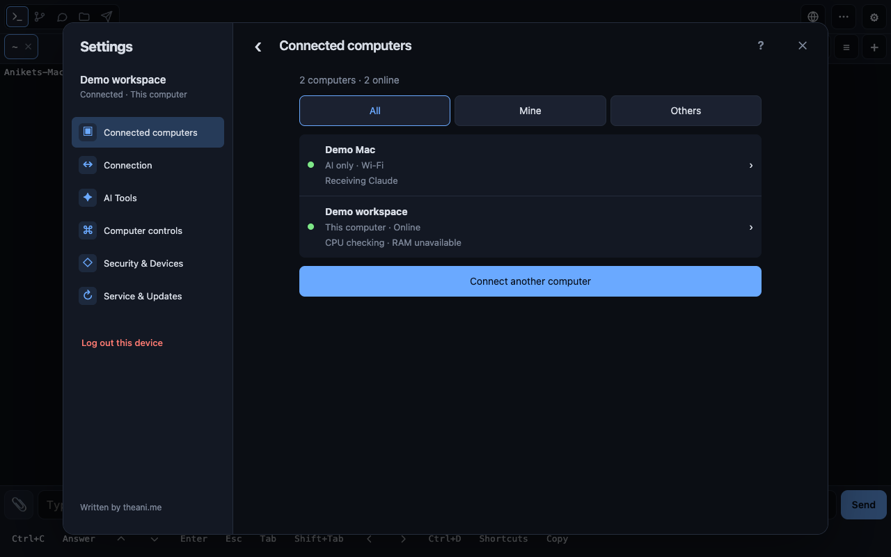
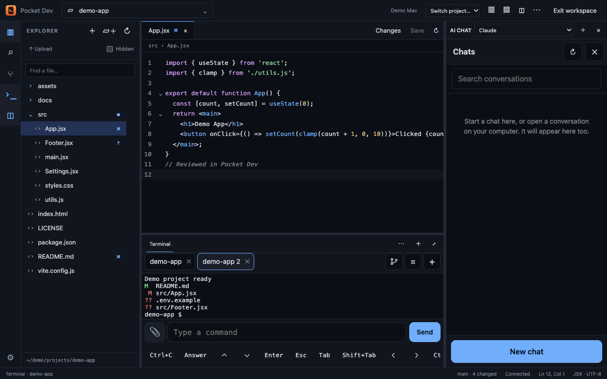

# Pocket Dev

**Your computer. In your pocket.**

Continue AI conversations across devices, share authorized AI capabilities and work on projects from one browser-based workspace.

Free and open source. Runs on your computer. Your phone needs only a browser.

[](https://www.npmjs.com/package/@anisirji/pocket-dev)  [](https://github.com/anisirji/pocket-dev/blob/main/LICENSE)

[Website](https://www.theani.me/work/pocket-dev) · [All features](https://github.com/anisirji/pocket-dev/blob/main/docs/FEATURES.md) · [Setup](https://github.com/anisirji/pocket-dev/blob/main/docs/START_HERE.md) · [Validation](https://github.com/anisirji/pocket-dev/blob/main/docs/FEATURE_VERIFICATION.md)

> **Version 3.0.1:** planned features are implemented. Final manual stability testing remains pending. The npm badge identifies the currently published version. [Validation](https://github.com/anisirji/pocket-dev/blob/main/docs/FEATURE_VERIFICATION.md) · [Release notes](https://github.com/anisirji/pocket-dev/blob/main/docs/RELEASE_3.0.md).

## Three reasons to use Pocket Dev

### AI Chat

**Start on your computer. Continue on your phone.**

Continue Claude Code and Codex conversations across devices, switch providers and respond to approvals. Local Antigravity and Copilot are experimental.



[Phone layout](https://raw.githubusercontent.com/anisirji/pocket-dev/main/docs/media/v3/ai-chat-mobile.png) · [Short demonstration](https://raw.githubusercontent.com/anisirji/pocket-dev/main/docs/media/v3/ai-chat.gif) · [Instructions](https://github.com/anisirji/pocket-dev/blob/main/docs/GUIDE.md#chat-with-claude-code-codex-antigravity-and-copilot)

### AI Sharing

**One team. More AI capabilities.**

Connect authorized computers and choose a compatible shared AI source while keeping your project on its workspace computer.



[Short demonstration](https://raw.githubusercontent.com/anisirji/pocket-dev/main/docs/media/v3/ai-sharing.gif) · [Instructions](https://github.com/anisirji/pocket-dev/blob/main/docs/UNIFIED_CONNECTIONS.md)

### Workspace

**Your project. One place.**

Use a VS Code-inspired editor, files, chat, terminal and Git in one workspace.



[Phone layout](https://raw.githubusercontent.com/anisirji/pocket-dev/main/docs/media/v3/workspace-mobile.png) · [Short demonstration](https://raw.githubusercontent.com/anisirji/pocket-dev/main/docs/media/v3/workspace.gif) · [Instructions](https://github.com/anisirji/pocket-dev/blob/main/docs/GUIDE.md#project-workspace)

*Actual Pocket Dev 3 UI, captured with disposable projects and sample data. AI responses are scripted. Media and native-control demonstrations use simulated sources where identified. [Capture details](https://github.com/anisirji/pocket-dev/blob/main/docs/media/v3/README.md).*

## Get started

Install the current published version on your computer with [Node.js 22+](https://nodejs.org/):

```sh
npm install -g @anisirji/pocket-dev
pocket-dev start
```

Follow setup → connect on the same Wi-Fi → scan the login QR privately → open a project. Keep the computer awake and connected.

[macOS](https://github.com/anisirji/pocket-dev/blob/main/docs/macos.md) · [Windows](https://github.com/anisirji/pocket-dev/blob/main/docs/windows.md) · [Linux](https://github.com/anisirji/pocket-dev/blob/main/docs/linux.md) · [Set up with AI](https://www.theani.me/work/pocket-dev/prompts) · [Test the 3.0.0 source preview](https://github.com/anisirji/pocket-dev/blob/main/docs/START_HERE.md#test-the-version-3-preview)

## Also included

| Feature | What it does |
| --- | --- |
| [Smart Notifications](https://github.com/anisirji/pocket-dev/blob/main/docs/FEATURES.md#smart-notifications) | Get a temporary alert and optional short sound when a task completes, fails or needs attention. |
| [Remote Screen & Control](https://github.com/anisirji/pocket-dev/blob/main/docs/FEATURES.md#remote-screen--control) | View an authorized computer's screen and choose displays or quality where supported; optional Mac input needs local approval. |
| [Camera & Audio](https://github.com/anisirji/pocket-dev/blob/main/docs/FEATURES.md#camera--audio) | View the host camera, listen to its microphone and use push to talk through its speakers with authorization. |
| [Developer Tools](https://github.com/anisirji/pocket-dev/blob/main/docs/FEATURES.md#developer-tools) | Use terminals, files, Git, development ports and device-to-device messages. |
| [Computer Management](https://github.com/anisirji/pocket-dev/blob/main/docs/FEATURES.md#computer-management) | See available health information, manage running apps and use supported power controls. |
| [Connected & Self-hosted](https://github.com/anisirji/pocket-dev/blob/main/docs/FEATURES.md#connected--self-hosted) | Connect locally or enable optional remote access; authorize devices with QR codes and manage permissions. |
| [Simple Setup & Help](https://github.com/anisirji/pocket-dev/blob/main/docs/FEATURES.md#simple-setup--help) | Install with npm, configure through guided Admin setup and use contextual instructions and diagnostics. |

[See every feature, screenshot and instruction](https://github.com/anisirji/pocket-dev/blob/main/docs/FEATURES.md).

## Your computer. Your control.

Local access is the default. No mobile app, centralized Pocket database or required Pocket cloud account. Optional tunnels, browser push and AI providers may use external services. Share only what you are authorized to share and what the provider permits. Platform and browser permissions still apply.

[Access and permissions](https://github.com/anisirji/pocket-dev/blob/main/ACCESS.md) · [AI sharing limits](https://github.com/anisirji/pocket-dev/blob/main/docs/UNIFIED_CONNECTIONS.md) · [Manual checks still pending](https://github.com/anisirji/pocket-dev/blob/main/docs/FEATURE_VERIFICATION.md)

## Documentation and support

[Start here](https://github.com/anisirji/pocket-dev/blob/main/docs/START_HERE.md) · [AI setup](https://github.com/anisirji/pocket-dev/blob/main/docs/AI_SETUP.md) · [Troubleshooting](https://github.com/anisirji/pocket-dev/blob/main/docs/GUIDE.md#troubleshooting) · [Reference](https://github.com/anisirji/pocket-dev/blob/main/docs/REFERENCE.md) · [Release notes](https://github.com/anisirji/pocket-dev/blob/main/docs/RELEASE_3.0.md)

[Report a bug](https://github.com/anisirji/pocket-dev/issues/new/choose) · [Discussions](https://github.com/anisirji/pocket-dev/discussions) · [Instagram](https://www.instagram.com/afk_pocket_dev)

Written by [theani.me](https://theani.me) and contributors, including [Rohit Kumar Das](https://www.linkedin.com/in/rohit-kumar-das-583b28223). ISC license. Preserve the copyright notice when redistributing.
