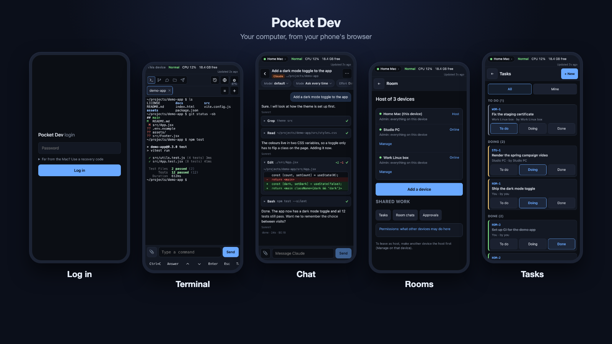

# Pocket Dev

<p align="center"></p>

**Control your computer from your phone's browser: terminals, Claude Code and Codex chats, Git, files and open apps. Runs on your own machine, nothing to install on the phone, no cloud account.**

[](https://www.npmjs.com/package/@anisirji/pocket-dev)  

> [!IMPORTANT]
> **Important before you start**
>
> - You need **Node.js 22 or newer** (`node -v`).
> - Your computer and phone must be on the **same Wi-Fi**.
> - Type the package name exactly: **`@anisirji/pocket-dev`**, with the `@` and with `-g`.
> - Your computer may ask about the **firewall**. Allow it on **Private networks**.
> - A different npm package called `pocket-dev` can take over the command. If you see `unknown command 'start'` or `EEXIST`, run `npm uninstall -g pocket-dev`, then install again.
> - The first `pocket-dev start` opens a short guided setup. It asks before every change. Run it again any time with `pocket-dev setup`.
> - **The install itself makes one change without asking:** `npm install -g` adds a **Pocket Dev Admin** shortcut with the Pocket Dev logo: a Dock tile on macOS, Desktop and Start menu shortcuts on Windows, an applications menu entry on Linux. Undo it with `pocket-dev admin unpin`. Skip it with `POCKET_DEV_NO_PIN=1` or `npm install -g --ignore-scripts`. `npx` and CI never add it.
>
> Step by step for your system: [Windows](https://github.com/anisirji/pocket-dev/blob/main/docs/windows.md), [macOS](https://github.com/anisirji/pocket-dev/blob/main/docs/macos.md), [Linux](https://github.com/anisirji/pocket-dev/blob/main/docs/linux.md).

## What's new in 2.0

2.0 is a big release, so it gets a new major version.

- **Four chat engines:** Claude Code, Codex, and, experimentally, Antigravity and GitHub Copilot.
- **Switch the provider and the model in one chat.** The whole conversation goes with you, long chats are compacted for the new model, and you can change the model at any time. The provider can change when no reply is running.
- **One way to continue between your computer and your phone:** Open **Chats** to see Pocket Dev chats and recent computer conversations together. Tap a conversation to continue here; use **Continue on computer** in chat settings to go back. Search and **Show more** find older conversations.
- **Removed: `pocket-dev takeover`.** Open the conversation in **Chats**, or use **Continue on computer** in chat settings instead.
- **Updating:** `pocket-dev update`, an update step in setup, an update icon on the phone, an **Update** button and banner on the Admin page, and a desktop notification until you are current.
- **The install now adds an Admin tile** to your Dock, Start menu or applications menu. Skip it with `POCKET_DEV_NO_PIN=1` or `npm install -g --ignore-scripts`, and remove it with `pocket-dev admin unpin`.
- **Files and photos:** the paperclips and **Upload** ask **Take photo**, **Photos and videos** or **Files** on phones. Take photo opens the camera, and Files opens Android's document browser.
- **An agents strip in terminals** for Claude Code helper agents, and the Pocket Dev logo.

Known limits: Antigravity and Copilot are experimental. The Windows and Linux paths for the Admin tile and the update notification were not run on real machines, and the Android file picker and a real four-engine switch are still to be checked on a phone. Details: [release notes](https://github.com/anisirji/pocket-dev/blob/main/docs/RELEASE_2.0.md).

## Quick start

You need [Node.js 22 or newer](https://nodejs.org) (`node -v` to check) and a phone on the same Wi-Fi.

**Want your coding assistant to set it up? [Copy the AI setup prompt](https://www.theani.me/work/pocket-dev/prompts).** Paste it into an assistant that can run commands on your own computer. The same page has a prompt for continuing your current project from your phone. [Setup details for agents](docs/AI_SETUP.md) · [Reusable agent skill](skills/pocket-dev/SKILL.md).

```
npm install -g @anisirji/pocket-dev
pocket-dev start
```

1. The first time, `pocket-dev start` opens the guided setup. It shows each command before it runs it and asks first. Claude Code, Codex, GitHub Copilot and the GitHub CLI are installed or logged in only if you say yes. The **Always on** step shows one list of recommended changes (start at login, Keep awake) and asks once.
2. At the end it prints an address like `http://192.168.1.25:7777` and a one-time QR code. If Pocket Dev now runs in the background, do not run `pocket-dev start` again. If you do, it says it is already running and prints a fresh QR code.
3. On your phone, scan the QR code (or open the address and type the password).

**Updating.** The guided setup starts by checking for a newer version and asks `Update now? [Y/n]` (Enter means yes), so a new install is current from the first minute. Later, `pocket-dev update` does the same, and `pocket-dev update --check` only says whether one exists. When a newer version is on npm, the phone shows an update icon beside the Settings gear and a notice every time you open Pocket Dev, and the Admin page shows an **Update** button that installs it on the computer and restarts the background service. The computer also gets a desktop notification while an update is waiting (`pocket-dev config set updateNotify false` turns that off). Installing stays on the computer: the phone only tells you.

**Privacy.** The only thing Pocket Dev looks up online by itself is the newest version number: one plain request to the npm registry, at most every six hours, with nothing about you or your computer in it. Turn it off with `pocket-dev config set updateCheck false` or `POCKET_DEV_NO_UPDATE_CHECK=1`. Everything else stays on your computer, as before.
4. If your computer asks, allow Pocket Dev through the firewall.

The Admin page is one click away from the Dock, Start menu or applications menu (see the note above). `pocket-dev admin pin --status` shows where it is. A new login code any time: `pocket-dev qr`. The guide again: `pocket-dev setup`. Scripts and CI never get a question: without a terminal, `pocket-dev start` prints the status and the command, then starts. `--no-setup` (or `POCKET_DEV_NO_SETUP=1`) skips the guide.

Just trying it? `npx -y @anisirji/pocket-dev start` runs it once and installs nothing.

## If something goes wrong

| You see | Do this |
| --- | --- |
| `unknown command 'start'. See 'main --help'` or `EEXIST ... pocket-dev.cmd` | A different npm package, `pocket-dev`, owns the command. Run `npm uninstall -g pocket-dev`, then `npm install -g @anisirji/pocket-dev` again. |
| `pocket-dev` is not recognised after installing | Close the terminal and open a new one. |
| Install fails on `node-pty` | Run `pocket-dev doctor --fix`. On macOS run `xcode-select --install` first. |
| `Version X is available` (update icon on the phone, banner on the Admin page) | Tap **Update** on the Admin page on your computer, or run `pocket-dev update` in a terminal there. |
| The phone cannot open the address | Same Wi-Fi? Firewall allowed? Port busy? Run `pocket-dev doctor`. |

More fixes: [Troubleshooting](https://github.com/anisirji/pocket-dev/blob/main/docs/GUIDE.md#troubleshooting).

## What you get

- **Terminals** that keep running when you close the page.
- **Chat** with your own Claude Code and Codex logins, and, experimentally, Antigravity and GitHub Copilot.
- **Switch the provider and the model in the same chat.** In the settings row, pick the Provider pill, then the Model pill. The whole conversation goes with you, an engine you have not installed yet shows how to install it, and the model can change even while a reply runs (it applies to the next reply).
- **Git** and **Files** on the computer where your work is.
- **Open apps, health and power** controls.
- **Several computers, one phone**, with per-device permissions.
- **Internet access** is optional and off by default.

## Docs

- [Set up with AI](https://www.theani.me/work/pocket-dev/prompts): copyable setup and project prompts, with an [agent setup guide](docs/AI_SETUP.md).
- Install, one page per system: [Windows](https://github.com/anisirji/pocket-dev/blob/main/docs/windows.md), [macOS](https://github.com/anisirji/pocket-dev/blob/main/docs/macos.md), [Linux](https://github.com/anisirji/pocket-dev/blob/main/docs/linux.md).
- [Beginner install guide](https://github.com/anisirji/pocket-dev/blob/main/docs/INSTALL_BEGINNERS.md): with pictures, for Windows, Mac and Linux.
- [Full guide](https://github.com/anisirji/pocket-dev/blob/main/docs/GUIDE.md): commands, configuration, rooms, internet access, security, limitations.
- [Guided setup](https://github.com/anisirji/pocket-dev/blob/main/docs/SETUP.md) and [reference](https://github.com/anisirji/pocket-dev/blob/main/docs/REFERENCE.md).


## Upcoming

- **Google Antigravity CLI (`agy`)**, as a third engine in Chat next to Claude Code and Codex. **Experimental:** tested by hand on macOS with Antigravity CLI 1.5.9, not yet on Windows or Linux. Details and open questions: [Roadmap](https://github.com/anisirji/pocket-dev/blob/main/docs/ROADMAP.md).
- **GitHub Copilot CLI (`copilot`)**, as a fourth engine in Chat. **Experimental:** tested on macOS against Copilot CLI 1.0.112 signed in with `copilot login`; not yet on Windows or Linux. Needs a GitHub Copilot plan, and every prompt counts against its premium requests. Details and open questions: [Roadmap](https://github.com/anisirji/pocket-dev/blob/main/docs/ROADMAP.md).

## Community and support

- **Ask a question or share a tip:** [GitHub Discussions](https://github.com/anisirji/pocket-dev/discussions)
- **Report a bug:** [open an issue](https://github.com/anisirji/pocket-dev/issues/new/choose) and paste the output of `pocket-dev doctor`
- **Source code:** [github.com/anisirji/pocket-dev](https://github.com/anisirji/pocket-dev)

Made by [anisirji](https://theani.me). Licence: ISC. If you use or build on this code, keep the copyright notice in `LICENSE` and please credit and link [theani.me](https://theani.me).
