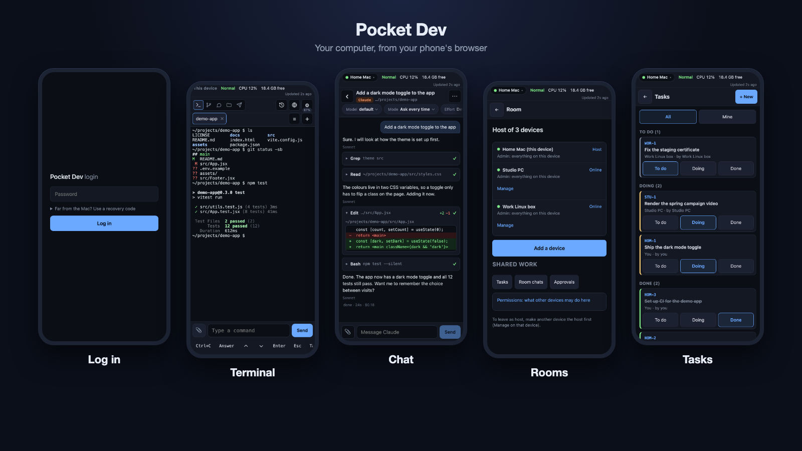

# Pocket Dev

<p align="center"></p>

**Control your computer from your phone's browser: terminals, Claude Code and Codex chats, Git, files and open apps. Runs on your own machine, nothing to install on the phone, no cloud account.**

[](https://www.npmjs.com/package/@anisirji/pocket-dev)  

> [!IMPORTANT]
> **Important before you start**
>
> - You need **Node.js 22 or newer** (`node -v`).
> - Your computer and phone must be on the **same Wi-Fi**.
> - Type the package name exactly: **`@anisirji/pocket-dev`**, with the `@` and with `-g`.
> - Your computer may ask about the **firewall**. Allow it on **Private networks**.
> - A different npm package called `pocket-dev` can take over the command. If you see `unknown command 'start'` or `EEXIST`, run `npm uninstall -g pocket-dev`, then install again.
> - The first `pocket-dev start` opens a short guided setup. It asks before every change. Run it again any time with `pocket-dev setup`.
>
> Step by step for your system: [Windows](https://github.com/anisirji/pocket-dev/blob/main/docs/windows.md), [macOS](https://github.com/anisirji/pocket-dev/blob/main/docs/macos.md), [Linux](https://github.com/anisirji/pocket-dev/blob/main/docs/linux.md).

## Quick start

You need [Node.js 22 or newer](https://nodejs.org) (`node -v` to check) and a phone on the same Wi-Fi.

```
npm install -g @anisirji/pocket-dev
pocket-dev start
```

1. The first time, `pocket-dev start` opens the guided setup. It shows each command before it runs it and asks first. Claude Code, Codex and the GitHub CLI are installed or logged in only if you say yes. The **Always on** step shows one list of recommended changes (start at login, Keep awake) and asks once.
2. At the end it prints an address like `http://192.168.1.25:7777` and a one-time QR code. If Pocket Dev now runs in the background, do not run `pocket-dev start` again. If you do, it says it is already running and prints a fresh QR code.
3. On your phone, scan the QR code (or open the address and type the password).
4. If your computer asks, allow Pocket Dev through the firewall.

A new login code any time: `pocket-dev qr`. The guide again: `pocket-dev setup`. Scripts and CI never get a question: without a terminal, `pocket-dev start` prints the status and the command, then starts. `--no-setup` (or `POCKET_DEV_NO_SETUP=1`) skips the guide.

Just trying it? `npx -y @anisirji/pocket-dev start` runs it once and installs nothing.

## If something goes wrong

| You see | Do this |
| --- | --- |
| `unknown command 'start'. See 'main --help'` or `EEXIST ... pocket-dev.cmd` | A different npm package, `pocket-dev`, owns the command. Run `npm uninstall -g pocket-dev`, then `npm install -g @anisirji/pocket-dev` again. |
| `pocket-dev` is not recognised after installing | Close the terminal and open a new one. |
| Install fails on `node-pty` | Run `pocket-dev doctor --fix`. On macOS run `xcode-select --install` first. |
| The phone cannot open the address | Same Wi-Fi? Firewall allowed? Port busy? Run `pocket-dev doctor`. |

More fixes: [Troubleshooting](https://github.com/anisirji/pocket-dev/blob/main/docs/GUIDE.md#troubleshooting).

## What you get

- **Terminals** that keep running when you close the page.
- **Chat** with your own Claude Code and Codex logins.
- **Git** and **Files** on the computer where your work is.
- **Open apps, health and power** controls.
- **Several computers, one phone**, with per-device permissions.
- **Internet access** is optional and off by default.

## Docs

- Install, one page per system: [Windows](https://github.com/anisirji/pocket-dev/blob/main/docs/windows.md), [macOS](https://github.com/anisirji/pocket-dev/blob/main/docs/macos.md), [Linux](https://github.com/anisirji/pocket-dev/blob/main/docs/linux.md).
- [Beginner install guide](https://github.com/anisirji/pocket-dev/blob/main/docs/INSTALL_BEGINNERS.md): with pictures, for Windows, Mac and Linux.
- [Full guide](https://github.com/anisirji/pocket-dev/blob/main/docs/GUIDE.md): commands, configuration, rooms, internet access, security, limitations.
- [Guided setup](https://github.com/anisirji/pocket-dev/blob/main/docs/SETUP.md) and [reference](https://github.com/anisirji/pocket-dev/blob/main/docs/REFERENCE.md).


## Upcoming

- **Google Antigravity CLI (`agy`)**, in the terminal and as a third engine in Chat next to Claude Code and Codex. Not available yet. Details and open questions: [Roadmap](https://github.com/anisirji/pocket-dev/blob/main/docs/ROADMAP.md).

## Community and support

- **Ask a question or share a tip:** [GitHub Discussions](https://github.com/anisirji/pocket-dev/discussions)
- **Report a bug:** [open an issue](https://github.com/anisirji/pocket-dev/issues/new/choose) and paste the output of `pocket-dev doctor`
- **Source code:** [github.com/anisirji/pocket-dev](https://github.com/anisirji/pocket-dev)

Made by [anisirji](https://theani.me). Licence: ISC. If you use or build on this code, keep the copyright notice in `LICENSE` and please credit and link [theani.me](https://theani.me).
