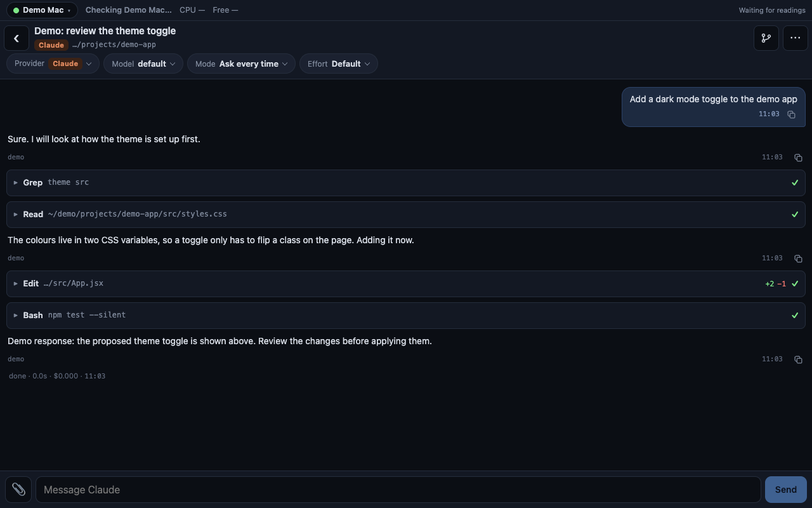
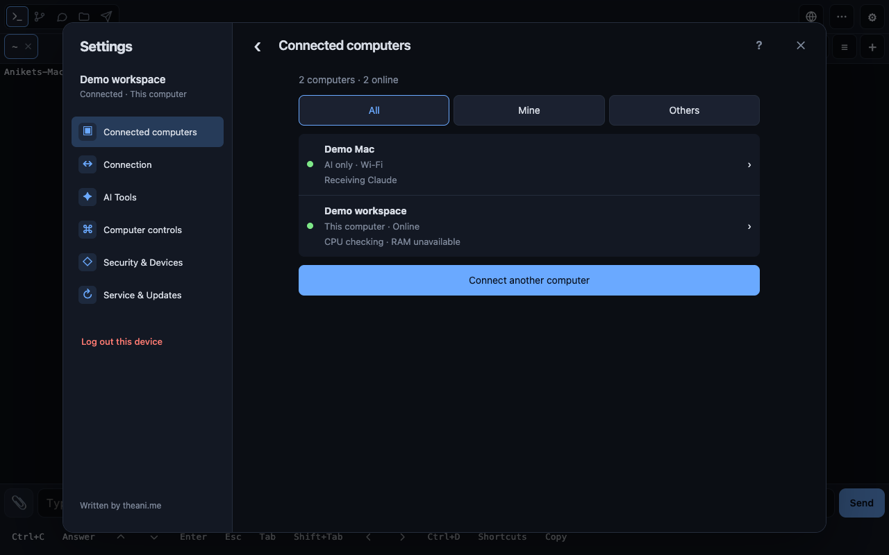
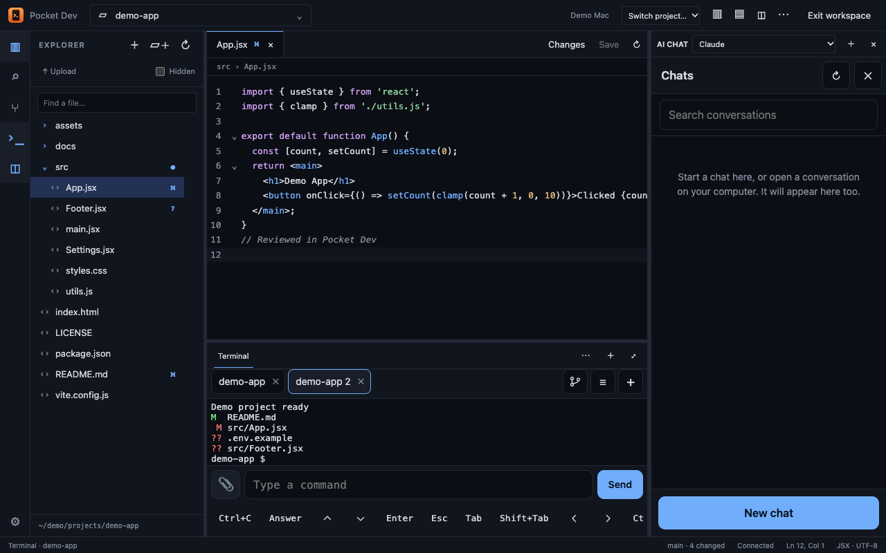
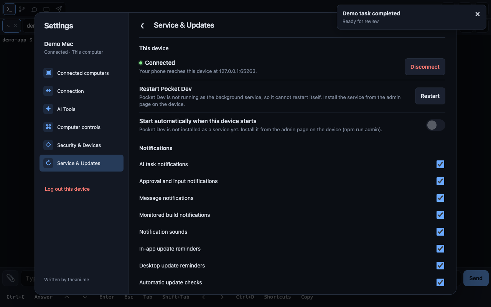
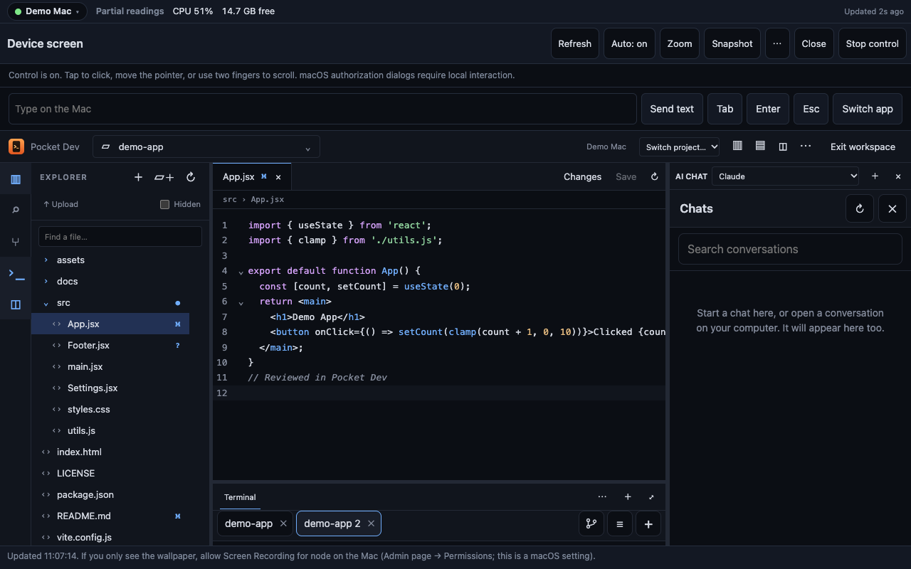
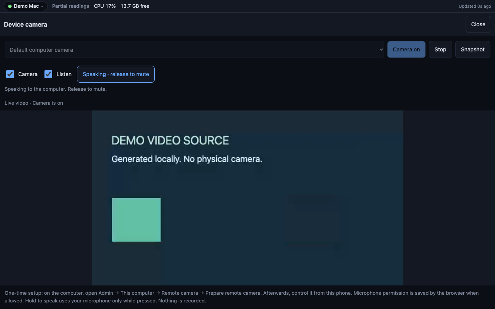
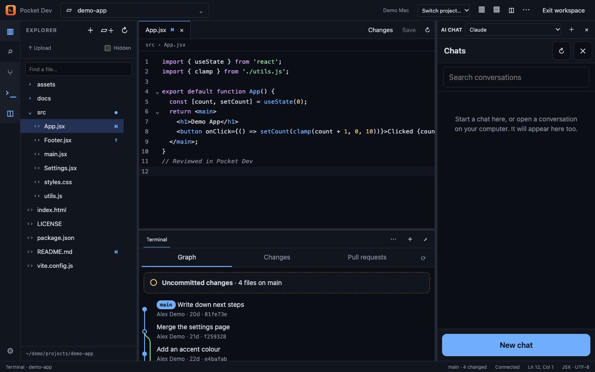
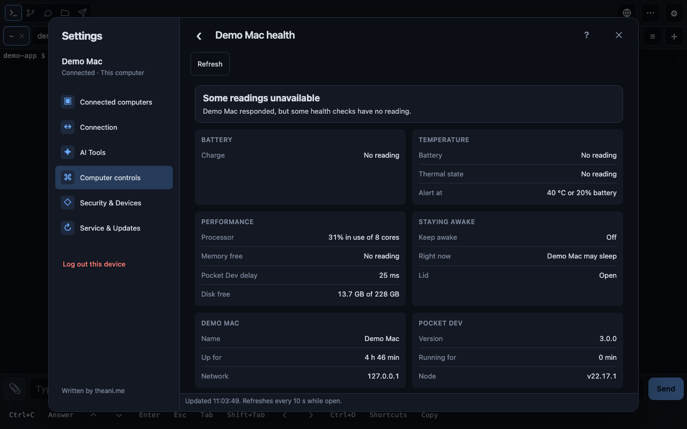
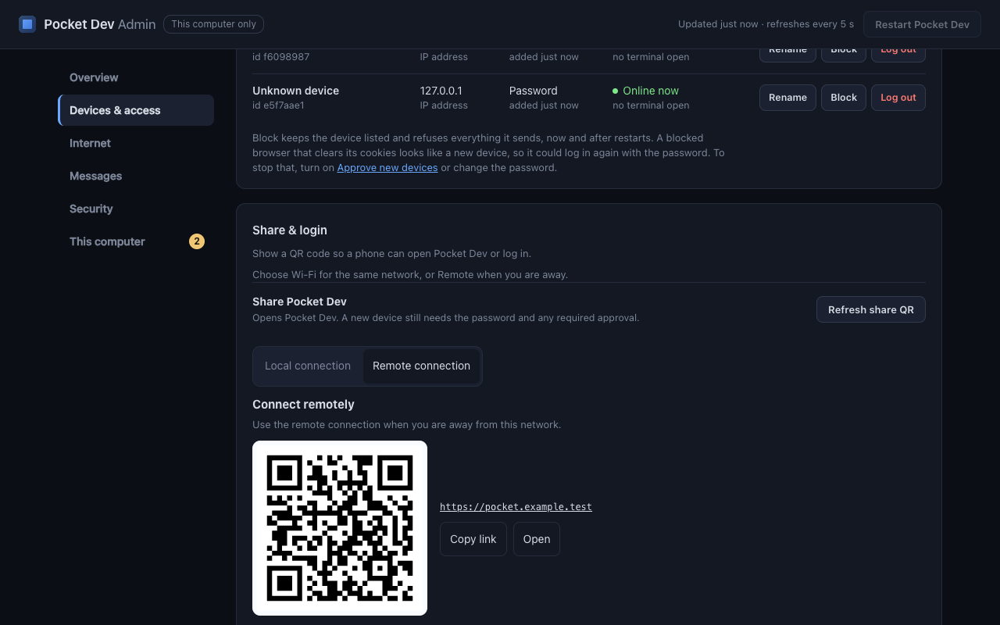
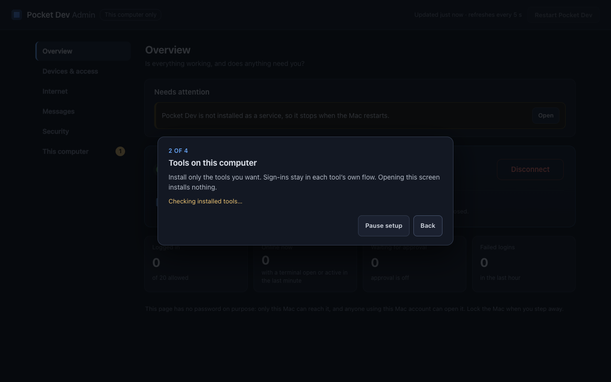

# Explore Pocket Dev 3

Continue AI conversations across devices, share authorized AI capabilities and work on projects from one browser-based workspace.

> **Version 3.0.0 preview:** planned features are implemented. Final manual stability testing and release approval are pending. The npm badge and install command refer to the published package, not this preview. [Validation](https://github.com/anisirji/pocket-dev/blob/main/docs/FEATURE_VERIFICATION.md) · [Release notes](https://github.com/anisirji/pocket-dev/blob/main/docs/RELEASE_3.0.md).

Actual application UI captured on disposable servers with sanitized sample projects. AI responses are scripted; desktop input and camera/audio sources are simulated where identified. Demonstrations do not certify physical hardware, provider entitlement or final manual stability.

## AI Chat

**Start on your computer. Continue on your phone.** Continue Claude Code and Codex conversations across devices, switch providers and respond to approvals.

[Short demonstration](media/v3/ai-chat.gif)

*Real conversation UI with scripted agent responses. The capture checks the continuation action; native account handoff still needs manual testing.*

- Phone ↔ computer handoff
- Provider/model switching, attachments and approvals
- Optional personal Codex browser tools; local Antigravity and Copilot experimental

### How to use it

1. Select the project computer, open Chats and choose a Claude Code or Codex conversation. An already-open conversation can read along before you send.
2. Send a message to continue here. Respect an active writer and review approvals before allowing an action.
3. Choose a compatible provider or model in the existing chat controls. Context is passed to the next engine; native tools can differ.
4. Open Chat settings → Continue on computer to return to the computer. Personal Codex Browser → Separate browser requires explicit consent.

**If it does not work:** Use the provider’s own sign-in on the computer running it. Keep the host awake. Usage limits come from the provider; a reset time appears only when the provider supplies one. Antigravity and Copilot remain experimental.

**Status:** implemented. Demonstrated in an isolated UI; final manual stability testing is pending. [Detailed guide](GUIDE.md#chat-with-claude-code-codex-antigravity-and-copilot).

## AI Sharing

**One team. More AI capabilities.** Connect authorized computers and choose a compatible shared AI source while keeping your project on its workspace computer.

[Short demonstration](media/v3/ai-sharing.gif)

*Two disposable servers on one Mac exercise pairing, provider grants and AI-only access boundaries. Physical cross-computer use and provider account permissions need manual testing.*

- Bidirectional provider grants
- Separate workspace and AI source
- Shared-session isolation; provider terms apply

### How to use it

1. Create a one-time connection code on one computer and enter it on the other.
2. For computers you own, approve computer access explicitly on the target computer.
3. For AI-only connections, share and authorize each provider separately.
4. Choose Work on for the project computer, and choose an AI source in the existing provider selector.

**If it does not work:** AI-only connections do not grant files, screen or health readings. CPU and RAM appear only for authorized online computers. Disconnecting or revoking a grant stops affected access.

**Status:** implemented. Demonstrated in an isolated UI; final manual stability testing is pending. [Detailed guide](UNIFIED_CONNECTIONS.md).

## Workspace

**Your project. One place.** Use a VS Code-inspired editor, files, chat, terminal and Git in one workspace.

[Short demonstration](media/v3/workspace.gif)

*Actual editor saves, terminal output and Git Graph in a scratch repository. No private project is used.*

- Live file changes, diffs and Git Graph
- Persistent tabs, drafts and conflict-safe saves
- Resizable panels and mobile layouts

### How to use it

1. Choose the computer that owns your project, then open its folder.
2. Edit files, use the project terminal, and select an AI source independently.
3. Git badges describe saved changes. Choose Changes to open the existing Git comparison.
4. Save explicitly or enable auto-save. If a file changes elsewhere, compare it before replacing your draft.
5. Use the Git action for the existing diff and Git Graph. Project terminals start in the selected folder.

**If it does not work:** Offline drafts stay in this browser. Reconnect to the same computer and project. Conflicts keep your draft until you choose how to resolve them.

**Status:** implemented. Demonstrated in an isolated UI; final manual stability testing is pending. [Detailed guide](GUIDE.md#project-workspace).

## Smart Notifications

**Know when your AI needs you.** Get a temporary alert and optional short sound when a task completes, fails or needs attention.

[Short demonstration](media/v3/notifications.gif)

*One toast and one sound-synthesis request verified for a repeated event ID. Output was muted; no external vendor push was sent.*

- Confirmed task status in Chats
- Deduplicated alerts, optional sounds
- Opt-in browser push where supported

### How to use it

1. Open Settings → Service & Updates and choose which alerts you want. Sounds start off.
2. Enable Notification sounds explicitly. A confirmed task outcome creates a temporary alert, not a notification inbox.
3. Dismiss the toast or let it expire. Repeated delivery of the same event must not replay its sound.
4. Browser push is a separate opt-in for supported browsers and secure connections; it needs the computer to stay online.

**If it does not work:** For an audible alert, interact with the page and check browser/system sound settings. Background push depends on browser and vendor support. A GIF demonstrates the toast but cannot demonstrate sound.

**Status:** implemented. Demonstrated in an isolated UI; final manual stability testing is pending. [Detailed guide](GUIDE.md#task-alerts).

## Remote Screen & Control

**See it. Interact when needed.** View an authorized computer's screen and choose displays or quality where supported; optional Mac input needs local approval.

[Short demonstration](media/v3/screen.gif)

*Real control UI, approval and revocation, with a demo Workspace image and inert input adapter. No owner desktop pixels or OS input are captured.*

- Screen viewing, pause and snapshots
- Display selection subject to platform validation
- Mac control with native permissions and host Stop

### How to use it

1. Keep the computer awake and signed in. Allow Screen Recording for the program running Pocket Dev on the Mac.
2. Use the options menu to choose a supported display or image quality. Snapshot downloads the current image.
3. Optional Mac input also needs Python 3 and Accessibility permission. Approve screen control once in local Admin; the approval covers all authorized connections to this computer.
4. Admin can be closed after approval. Stop ends a connection; Admin → Permissions disables access globally and immediately. Reconnecting requires a fresh Control request but no repeated approval while permission remains enabled.

**If it does not work:** Wallpaper without app windows usually means Screen Recording needs permission. Locked screens and macOS authorization dialogs block input. Only one controller is allowed. Native input remains subject to the Mac’s permissions; unsupported computers retain viewing.

**Status:** implemented. Demonstrated in an isolated UI; final manual stability testing is pending. [Detailed guide](GUIDE.md#device-screen).

## Camera & Audio

**See, listen and speak.** View the host camera, listen to its microphone and use push to talk through its speakers with authorization.

[Short demonstration](media/v3/camera-audio.gif)

*Real WebRTC UI and packet flow with generated video/audio. No physical camera, private microphone recording or audible-quality claim.*

- Independent camera and audio controls
- Two-way audio and push to talk
- No automatic recording; physical device and playback behavior depends on permissions and browser policy

### How to use it

1. Prepare the camera from the computer’s local Admin page if you want video. Camera permission does not grant microphone access.
2. Choose Camera and Listen independently, then start. Turn Camera off for an audio-only session. Listen asks for the computer microphone separately.
3. On a supported secure phone address, hold to speak through the computer. Allow your microphone if asked, then hold again. Releasing stops its audio track.
4. Snapshot saves a video frame to your device. Stop, leave the page or use Stop camera & audio on the computer to end media access.

**If it does not work:** Keep the computer browser open and allow each requested permission. If speaker autoplay is blocked, use Enable speaker playback in the computer tab. Audio requires direct WebRTC; image fallback preserves video only. Phone microphone access needs HTTPS or another supported secure context. Nothing is recorded.

**Status:** implemented. Demonstrated in an isolated UI; final manual stability testing is pending. [Detailed guide](CAMERA.md).

## Developer Tools

**Everything close at hand.** Use terminals, files, Git, development ports and device-to-device messages.

[Short demonstration](media/v3/developer-tools.gif)

*Real scratch files, PTY output, Git status and graph. No private project or external development port is exposed.*

- Terminal sessions and shortcuts
- File transfers, previews and ZIP
- Git graph, branches and pull requests

### How to use it

1. Choose the project computer and open a terminal in its project folder.
2. Use Files for uploads, downloads, previews and folder ZIPs within your authorized roots.
3. Use Git for status, saved-file diffs, Git Graph and supported repository actions.
4. Open a development port only for the intended task, then close it when finished.

**If it does not work:** Git needs Git installed; native terminals need working PTY support. File and project permissions still apply. Only forward a service you intend to expose.

**Status:** implemented. Demonstrated in an isolated UI; final manual stability testing is pending. [Detailed guide](GUIDE.md).

## Computer Management

**Know how your computer is doing.** See available health information, manage running apps and use supported power controls.

[Short demonstration](media/v3/computer-management.gif)

*Existing controls and health interface; platform-dependent readings stay available or unavailable as reported. No power action is executed.*

- CPU, memory, battery and available sensors
- Connected computer availability
- Start at login, keep awake and power controls

### How to use it

1. Select the authorized computer you want to inspect.
2. Use Applications or Device health to inspect its actual supported capabilities.
3. Open Screen or Camera only when you need a preview.
4. Review a confirmation carefully before using power controls.

**If it does not work:** Capabilities depend on the computer and its permissions. Unsupported controls remain unavailable, and closing a preview releases its active resources.

**Status:** implemented. Demonstrated in an isolated UI; final manual stability testing is pending. [Detailed guide](GUIDE.md#open-apps-health-and-power).

## Connected & Self-hosted

**Your computers. Your control.** Connect locally or enable optional remote access; authorize devices with QR codes and manage permissions.

[Short demonstration](media/v3/connectivity.gif)

*Local/Remote share-address UI using an isolated tunnel fixture. No login QR, credential or real public tunnel is captured.*

- Local and Remote QR selector
- Optional Cloudflare tunnel
- Separate device and provider permissions

### How to use it

1. For Wi-Fi access, put the phone and computer on the same reachable network.
2. Open the Local connection address or scan a fresh login QR privately. Local remains available when Remote Access is enabled.
3. Configure optional internet access from the computer’s Admin page.
4. Keep the computer running; Pocket Dev does not wake sleeping hardware.
5. Use the shared Local and Remote selector to copy or open the intended connection. Sharing an address does not grant a login.

**If it does not work:** Check the current address and private-network firewall rules. A Wi-Fi HTTP address supports live alerts, but browser push and phone microphone access require a supported secure context.

**Status:** implemented. Demonstrated in an isolated UI; final manual stability testing is pending. [Detailed guide](UNIFIED_CONNECTIONS.md).

## Simple Setup & Help

**Get running without the guesswork.** Install with npm, configure through guided Admin setup and use contextual instructions and diagnostics.

[Short demonstration](media/v3/setup.gif)

*Actual graphical setup and existing contextual help. No installer, system permission dialog or password change is executed.*

- Node.js 22+ and capability checks
- Predefined setup actions with approval
- Notification preferences, updates and recovery

### How to use it

1. Run pocket-dev start on your own computer.
2. Open its local Admin page and follow the setup and permission guidance.
3. Install optional AI tools and sign in through their own login flows.
4. Connect your phone on Wi-Fi and verify the features you intend to use before leaving the computer.

**If it does not work:** Use pocket-dev setup --check or pocket-dev doctor for diagnostics. Keep the existing config and state directories when updating. A missing optional agent does not prevent basic Pocket Dev use.

**Status:** implemented. Demonstrated in an isolated UI; final manual stability testing is pending. [Detailed guide](SETUP.md).

## Compatibility and validation

Mac native input needs local approval and OS permissions. Camera, microphone and speaker activation follow browser policy. Shared AI uses isolated workspaces and does not inherit a provider host’s personal browser, MCP tools or subscription entitlements.

- Safari compatibility and a real phone on the intended network
- Windows physical camera, microphone and audible speaker playback
- Native screen capture/input permissions, multiple monitors and host Stop on each supported target
- Real provider sign-in, conversation handoff and authorized cross-computer AI with the intended accounts
- External tunnel connectivity and real vendor browser-push delivery
- Power controls on the intended hardware after saving work

[Verification matrix](FEATURE_VERIFICATION.md) · [Historical validation](VALIDATION.md) · [Access](../ACCESS.md).
