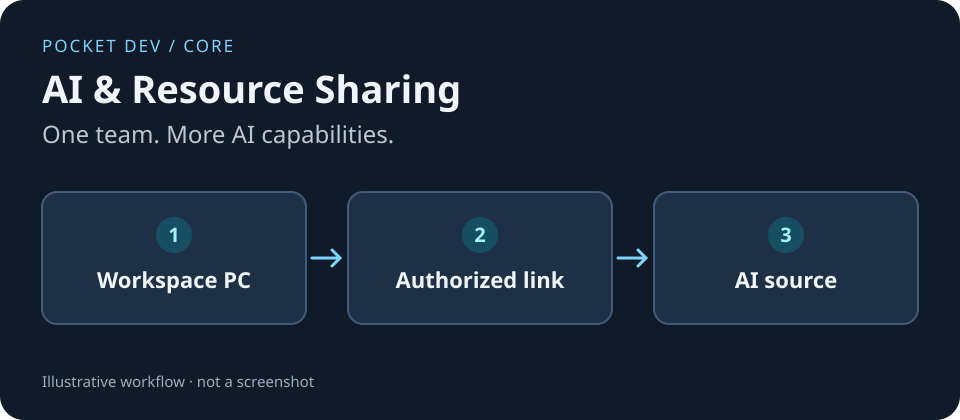
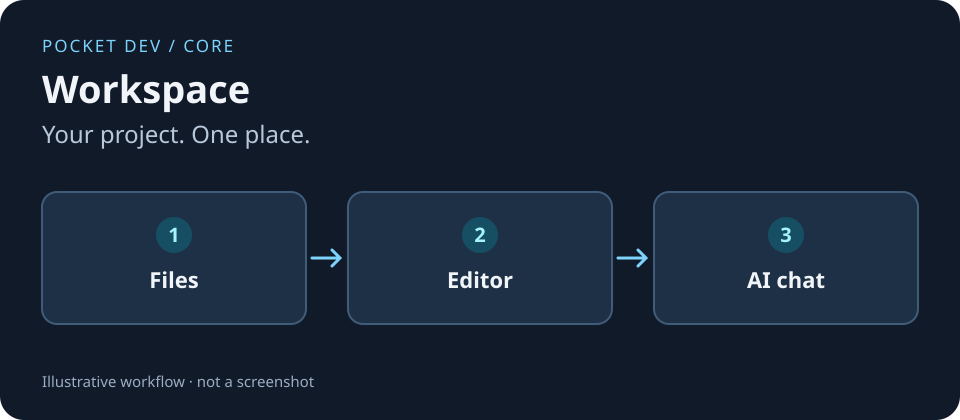
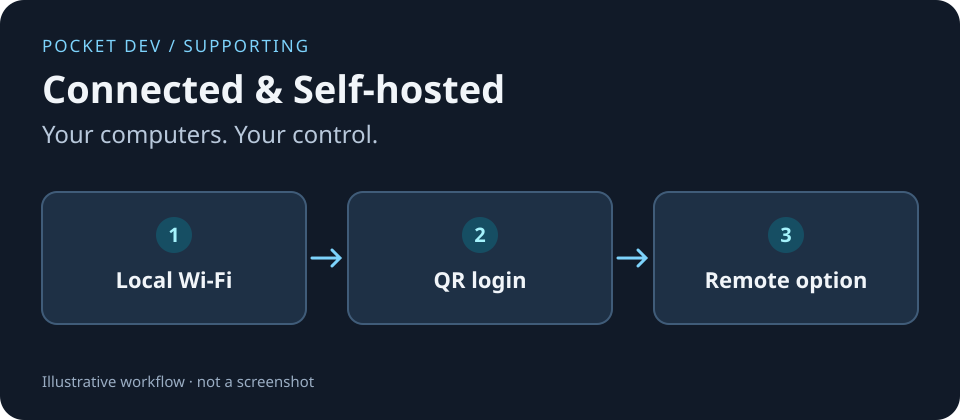

# Explore Pocket Dev 3

Continue AI conversations across devices, connect your team's authorized AI capabilities and develop projects from one browser-based workspace.

> **Version 3 preview:** 3.0.0 is in development and not yet published to npm. Manual validation is pending. The npm badge shows the published version; diagrams illustrate workflows. See [release notes](https://github.com/anisirji/pocket-dev/blob/main/docs/RELEASE_3.0.md).

## AI Chat

**Start on your computer. Continue on your phone.** Continue Claude Code and Codex conversations across devices, switch providers and respond to approvals.

- Phone ↔ computer handoff
- Provider/model switching, attachments and approvals
- Optional personal Codex browser tools; local Antigravity and Copilot experimental

[Detailed guide](https://github.com/anisirji/pocket-dev/blob/main/docs/GUIDE.md#chat-with-claude-code-codex-antigravity-and-copilot)

## AI & Resource Sharing

**One team. More AI capabilities.** Connect authorized computers and choose a compatible shared AI source while keeping your project on its workspace computer.

- Bidirectional provider grants
- Separate workspace and AI source
- Shared-session isolation; provider terms apply

[Detailed guide](https://github.com/anisirji/pocket-dev/blob/main/docs/UNIFIED_CONNECTIONS.md)

## Workspace

**Your project. One place.** Use a VS Code-inspired editor, files, chat, terminal and Git in one workspace.

- Live file changes, diffs and Git Graph
- Persistent tabs, drafts and conflict-safe saves
- Resizable panels and mobile layouts

[Detailed guide](https://github.com/anisirji/pocket-dev/blob/main/docs/GUIDE.md#project-workspace)

## Smart Notifications

**Know when your AI needs you.** Get a short sound and temporary alert when a task completes, fails or needs attention — no notification inbox.

- Confirmed task status in Chats
- Deduplicated alerts, optional sounds
- Opt-in browser push where supported

## Remote Screen & Control

**See it. Interact when needed.** View an authorized computer's screen and choose displays or quality where supported; optional Mac input needs local approval.

- Screen viewing, pause and snapshots
- Display selection subject to platform validation
- Mac control with native permissions and host Stop

## Camera & Audio

**See, listen and speak.** View the host camera, listen to its microphone and use push to talk through its speakers with authorization.

- Independent camera and audio controls
- Two-way audio and push to talk
- No automatic recording; audible playback still to be verified

[Detailed guide](https://github.com/anisirji/pocket-dev/blob/main/docs/CAMERA.md)

## Developer Tools

**Everything close at hand.** Use terminals, files, Git, development ports and device-to-device messages.

- Terminal sessions and shortcuts
- File transfers, previews and ZIP
- Git graph, branches and pull requests

[Detailed guide](https://github.com/anisirji/pocket-dev/blob/main/docs/GUIDE.md)

## Computer Management

**Know how your computer is doing.** See available health information, manage running apps and use supported power controls.

- CPU, memory, battery and available sensors
- Connected computer availability
- Start at login, keep awake and power controls

[Detailed guide](https://github.com/anisirji/pocket-dev/blob/main/docs/GUIDE.md#open-apps-health-and-power)

## Connected & Self-hosted

**Your computers. Your control.** Connect locally or enable optional remote access; authorize devices with QR codes and manage permissions.

- Local and Remote QR selector
- Optional Cloudflare tunnel
- Separate device and provider permissions

[Detailed guide](https://github.com/anisirji/pocket-dev/blob/main/docs/UNIFIED_CONNECTIONS.md)

## Simple Setup & Help

**Get running without the guesswork.** Install with npm, configure through guided Admin setup and use contextual instructions and diagnostics.

- Node.js 22+ and capability checks
- Predefined setup actions with approval
- Notification preferences, updates and recovery

[Detailed guide](https://github.com/anisirji/pocket-dev/blob/main/docs/SETUP.md)

## Compatibility

Mac desktop input requires local approval. Audible speaker output, physical phones, Safari, multiple monitors and real vendor push delivery still need verification. Shared AI must retain isolation; project content needed for AI may reach its source host and service. Do not infer equivalent native tools across providers or platforms. [Validation and limits](https://github.com/anisirji/pocket-dev/blob/main/docs/RELEASE_3.0.md).
