# Pocket Dev

<p align="center">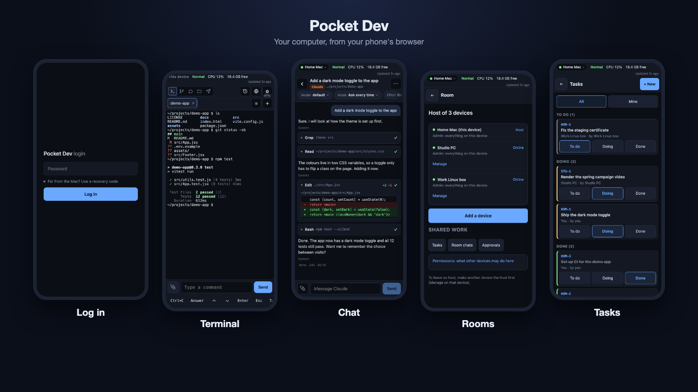</p>

<p align="center"><b>Control your computers from your phone's browser: terminals, Claude Code and Codex chats, Git, files and more. Several computers, one phone, no cloud account.</b></p>

<p align="center">
<a href="https://www.npmjs.com/package/@anisirji/pocket-dev"></a>


</p>

Pocket Dev is one Node.js server that runs on a computer as your user. Your phone opens `http://<computer-address>:7777` on the same Wi-Fi, logs in with a password or a one-time QR code, and gets a mobile web app. Nothing is installed on the phone. macOS is the best tested system, Windows 11 is tested for the main features on a real PC, and Linux is written but not tested on a real machine.

## Set it up in 5 minutes

<p align="center">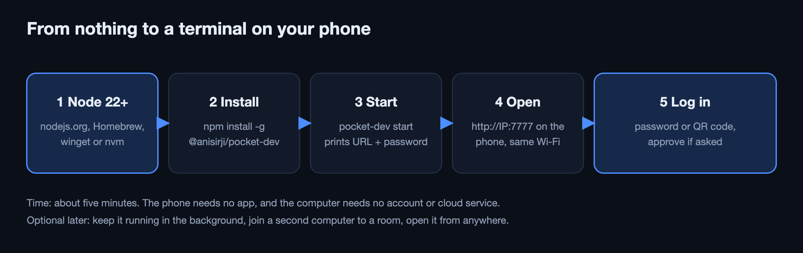</p>

You need a computer (Mac, Windows 11 or Linux) and a phone on the same Wi-Fi. You do not need to know Node. Pick your system, follow the numbered steps, and compare what you see with the line under each step.

> **New to the terminal? Follow the picture-by-picture beginner guide:** the full guide ships inside the package at `docs/INSTALL_BEGINNERS.md`. Its contents and first three steps are right below, under **Beginner guide**.

> **Use the name with the `@` and `-g`: `npm install -g @anisirji/pocket-dev`.** `npm i anisirji/pocket-dev` (no `@`) installs from GitHub, not from npm, into the current folder, and does not create the `pocket-dev` command.

Want to try it first without installing? `npx -y @anisirji/pocket-dev start` runs it once and leaves nothing behind (it is slower to start).

> **Guided setup on the first start.** The first `pocket-dev start` on a computer opens the guided setup before the server starts (`pocket-dev setup` runs it again any time). It checks Node, Git, Claude Code, Codex, the GitHub CLI and Cloudflare's `cloudflared`, shows the exact command before it installs anything, and offers each tool's own login (`claude auth login`, `codex login`, `gh auth login`). Claude Code, Codex and the GitHub CLI are accounts, so their install and login default to no. Then it sets your password and the phone access, and the **Always on** step shows one list of recommended changes (start at login, Keep awake) and asks once. It ends with the address, a one-time QR code and a short note from the author, Ani (`--quiet` hides it). Without a terminal (a script, CI) the start prints the status table and the command, and goes on; `pocket-dev start --no-setup` or `POCKET_DEV_NO_SETUP=1` skips the guide. `pocket-dev setup --check` only shows the status; `--dry-run` shows the plan. Details: [docs/SETUP.md](SETUP.md). The same checklist is in Settings, under **Tools on this computer**.

### Beginner guide

<p align="center">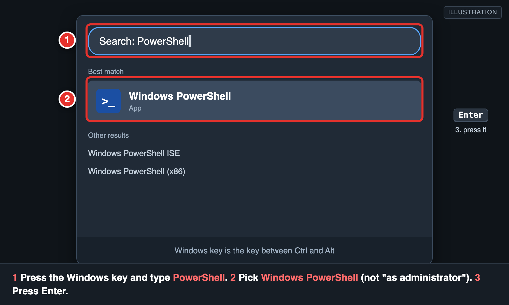</p>

The full guide (Windows, Mac and Linux, with pictures, a glossary and a fix for each common error) is the file `docs/INSTALL_BEGINNERS.md` in this package. The pictures are drawings that show what to look for. In short:

1. **Open the command window.** Windows: press the Windows key, type **PowerShell**, press Enter (not "as administrator"). Mac: press Cmd+Space, type **Terminal**, press Enter. Linux: press Ctrl+Alt+T. It is safe: it does only what you type.
2. **Check Node.js.** Type **`node -v`** and press Enter. `v22` or higher is good. "Not recognized" or "command not found" means it is not installed.
3. **Install Node.js** (skip if step 2 was good). Open [nodejs.org](https://nodejs.org), click the big green **LTS** button, run the installer (Next, Next, Next; tick nothing special), then **close the window and open a new one** and check `node -v` again. Windows can also use `winget install OpenJS.NodeJS.LTS`; Mac can use `brew install node`; Linux can use [nvm](https://github.com/nvm-sh/nvm) and `nvm install 22`.

Then: **4** `npm install -g @anisirji/pocket-dev`, **5** `pocket-dev start` (the first time, the guided setup opens; copy the one-time password), **6** allow it through the firewall, **7** open the address on your phone, **8** start by itself (the Always on step of the setup), **9** `pocket-dev setup` again any time, **10** add a second computer (optional). Then, if stuck: **If something goes wrong** and **How to ask for help**, both in the guide.

### macOS

1. **Install Node 22 or newer.** Easiest with [Homebrew](https://brew.sh): **`brew install node`**. Or download the LTS installer from [nodejs.org](https://nodejs.org). Check with **`node -v`**: it should print `v22` or higher.
2. **Install Pocket Dev:** **`npm install -g @anisirji/pocket-dev`**. If it fails while building `node-pty`, run **`xcode-select --install`** once and repeat.
3. **Start it:** **`pocket-dev start`**. It prints a QR code, then lines like these (the password appears this one time only, so copy it):
   ```
   Pocket Dev running at http://192.168.1.20:7777
   Password: Xk3p9QwR2tLm
   ```
   The Admin page also opens in your Mac's browser (add `--no-open` to stop that).
4. **Find the address** if you missed it: **`ipconfig getifaddr en0`** prints the Wi-Fi address (use `en1` if `en0` prints nothing). The URL is `http://<that address>:7777`. If macOS asks whether `node` may accept incoming connections, choose **Allow**.
5. **Open the URL on the phone** (same Wi-Fi) and log in with the password, or scan the QR code with the phone camera (it logs you in once, for 10 minutes). Forgot the password? Run **`pocket-dev admin`**, open **Password**, and set a new one. No old password is needed.
6. **Approve the device if asked.** If **Approve new devices** is on, the phone waits and the Mac Admin page (**Waiting**) shows a 4-character code to compare. It is off by default.
7. **Keep it running** in the background and at login: **`pocket-dev service install`**. Check with **`pocket-dev service status`**.
8. **Optional:** add a second computer, see [Rooms](#rooms-several-computers-one-phone).
9. **Update:** `npm install -g @anisirji/pocket-dev@latest` then `pocket-dev service restart`. **Uninstall:** `pocket-dev service uninstall` then `npm uninstall -g @anisirji/pocket-dev`. Settings stay in `~/.pocket-dev` until you delete that folder.

### Windows 11

1. **Install Node 22 or newer.** In PowerShell: **`winget install OpenJS.NodeJS.LTS`**, or use the installer from [nodejs.org](https://nodejs.org). Close PowerShell and open a new one, then **`node -v`** should print `v22` or higher. For the Git view also install Git: `winget install --id Git.Git -e`.
2. **Install Pocket Dev:** **`npm install -g @anisirji/pocket-dev`**. A prebuilt `node-pty` is used when one exists. If the install fails on `node-pty`, install **Visual Studio Build Tools** (the "Desktop development with C++" workload) and **Python 3**, then run the command again.
3. **Start it:** **`pocket-dev start`**. You should see `Pocket Dev running at http://192.168.…:7777` and a `Password:` line (shown once, copy it).
4. **Firewall:** Windows asks whether Node may accept connections. Choose **Private networks** and Allow. Find the PC's address with **`ipconfig`** (the IPv4 address of your Wi-Fi). On the PC itself you can use `http://localhost:7777`.
5. **Open the URL on the phone** (same Wi-Fi) and log in with the password, or scan the QR code the start printed. Forgot the password? Run **`pocket-dev admin`** and set a new one under **Password**.
6. **Approve the device if asked** (only when **Approve new devices** is on): approve it on the PC's Admin page, **Waiting**.
7. **Keep it running without a window:** **`Start-Process pocket-dev.cmd -ArgumentList 'start','--no-open' -WindowStyle Hidden`**. The Admin page (`pocket-dev admin`, **Service**) can also install a start-at-login Task Scheduler task; that part is written but not tested on a real PC. `pocket-dev service` is macOS only. After installing a tool such as Git, restart Pocket Dev so its terminals see the new PATH.
8. **Optional:** join it to a room, see [Rooms](#rooms-several-computers-one-phone).
9. **Update:** `npm install -g @anisirji/pocket-dev@latest`, then stop and start it again. **Uninstall:** `npm uninstall -g @anisirji/pocket-dev`. Settings and data live in `%USERPROFILE%\.pocket-dev` until you delete that folder.

Do not use the remote **Sleep** button on a Windows PC unless you know it wakes: Windows may hibernate, and nothing remote can wake it. Temperature, lid control and window names are not available on Windows.

### Linux

Written for Linux and not yet tested on a real machine. Tell us what breaks.

1. **Install Node 22 or newer.** With [nvm](https://github.com/nvm-sh/nvm): **`nvm install 22`**. Or use your distribution's package or [NodeSource](https://github.com/nodesource/distributions); distribution packages are often older, so check **`node -v`**.
2. **Install Pocket Dev:** **`npm install -g @anisirji/pocket-dev`**. If `node-pty` has to be built, install **`build-essential`** and **Python 3** first (for example `sudo apt install build-essential python3`).
3. **Start it:** **`pocket-dev start`**. It prints the URL and a `Password:` line (shown once).
4. **Find the address:** **`hostname -I`** prints the computer's addresses; use the Wi-Fi or LAN one: `http://<address>:7777`. If a firewall is on, allow TCP port 7777 from your local network.
5. **Open the URL on the phone** (same Wi-Fi) and log in, or scan the printed QR code. Forgot the password? Run **`pocket-dev admin`** (needs a browser on that computer) and set a new one.
6. **Approve the device if asked** on the Admin page, **Waiting**.
7. **Keep it running:** the Admin page's **Service** section installs a systemd user unit (written, not tested). A simple alternative is **`nohup pocket-dev start --no-open > ~/pocket-dev.log 2>&1 &`**. `pocket-dev service` is macOS only.
8. **Optional:** join it to a room, see [Rooms](#rooms-several-computers-one-phone).
9. **Update:** `npm install -g @anisirji/pocket-dev@latest`, then restart. **Uninstall:** `npm uninstall -g @anisirji/pocket-dev`; settings stay in `~/.pocket-dev`.

### What you should see

<table><tr><td align="center" valign="top">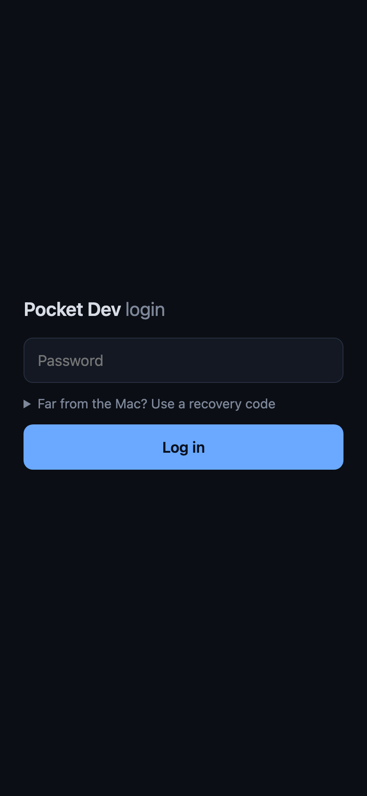<br><sub>Log in with the printed password</sub></td><td align="center" valign="top">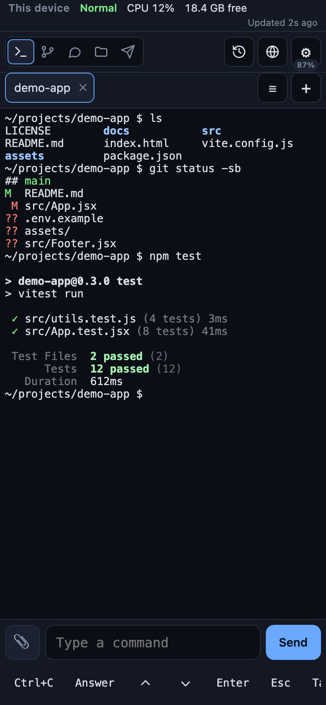<br><sub>Your first terminal</sub></td><td align="center" valign="top">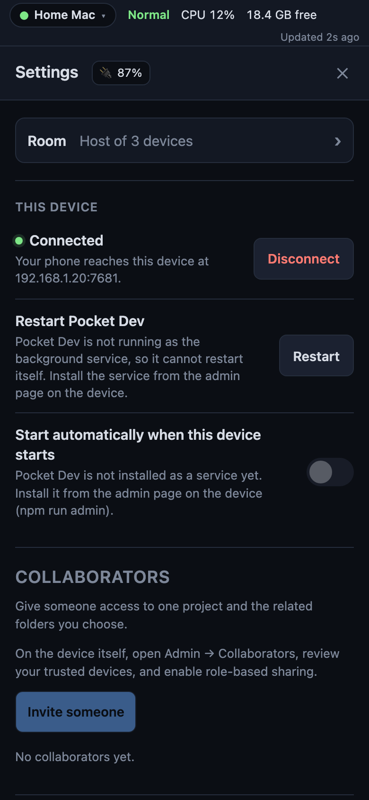<br><sub>Settings</sub></td></tr></table>

### Common first-time mistakes

| What happened | Fix |
| --- | --- |
| `pocket-dev` is "not recognized" or "command not found" | You skipped `-g`, or the terminal is older than the install. Open a **new** terminal. Check that npm's global folder is on your PATH: `npm config get prefix` (the command lives there, in `bin` or the folder itself on Windows). |
| `npm i anisirji/pocket-dev` was used | That installs from GitHub into the current folder and makes no command. Delete the stray `node_modules` and `package.json` it created, then run `npm install -g @anisirji/pocket-dev`. |
| Windows: `ENOENT`, `TAR_ENTRY_ERROR` or `spawn cmd.exe ... node-pty` | Files went missing while npm unpacked. See the Windows ENOENT entry in [Troubleshooting](#troubleshooting). |
| The phone cannot open the address | Same Wi-Fi? Firewall prompt answered? See [Troubleshooting](#troubleshooting). |
| The phone's Terminal view says "Terminals are not available on this computer" | The optional terminal part (`node-pty`) is missing. On the computer run **`pocket-dev doctor --fix`**, then restart Pocket Dev. Everything else works meanwhile. |

**Something not working?** Run **`pocket-dev doctor`** on the computer. It checks Node, npm's PATH, terminals, tools and the port, and prints the exact command for each problem. See also [Troubleshooting](#troubleshooting).

## Why Pocket Dev

- **Your own computer, from your pocket.** Real terminals, your Claude Code and Codex logins, Git, files and open apps, on the machine where your work already is.
- **No cloud in the middle.** Each computer runs its own server and talks to your phone over your Wi-Fi. Nothing is installed on the phone. Internet access is optional and off by default.
- **Several computers, one phone.** Join them into a room, switch between them, share tasks and messages, and decide per device how much it may do.

<p align="center">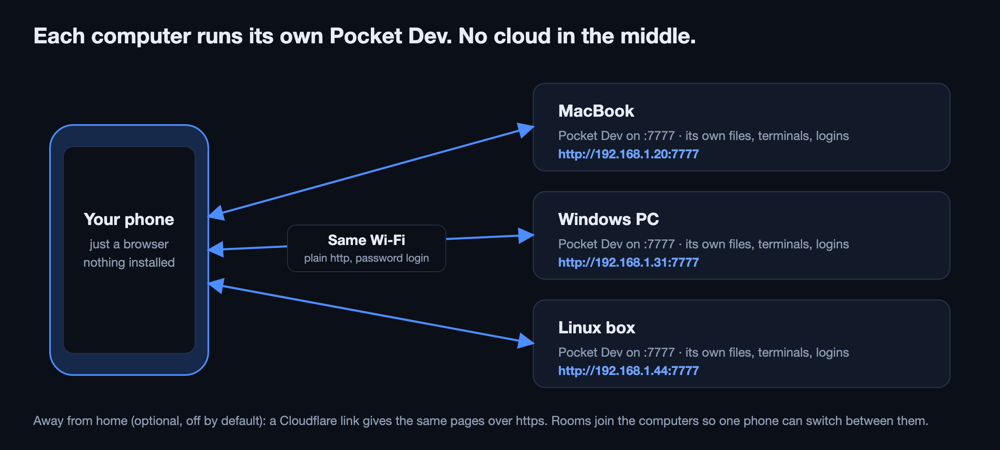</p>

## Tour

Details for every feature are in [docs/REFERENCE.md](REFERENCE.md). A one-page summary of what Pocket Dev can reach on the computer is in [ACCESS.md](../ACCESS.md).

### Terminals

<table><tr><td align="center" valign="top"><br><sub>Terminal with the compact key bar</sub></td></tr></table>

Each tab is a login shell in a real pty (zsh or your `$SHELL` on macOS and Linux, PowerShell on Windows). Terminals keep running when the phone sleeps or you change tabs, and reconnect with recent output replayed. A folder picker, shortcuts, uploads and a Copy view are built in. Terminals do not survive a computer restart.

### Files

<table><tr><td align="center" valign="top">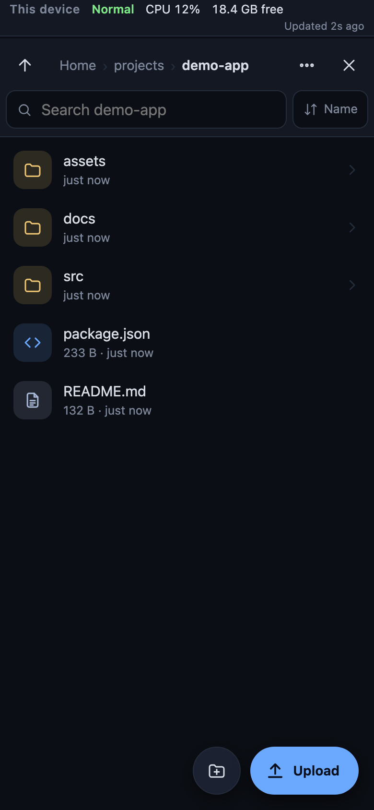<br><sub>Browse and upload</sub></td><td align="center" valign="top">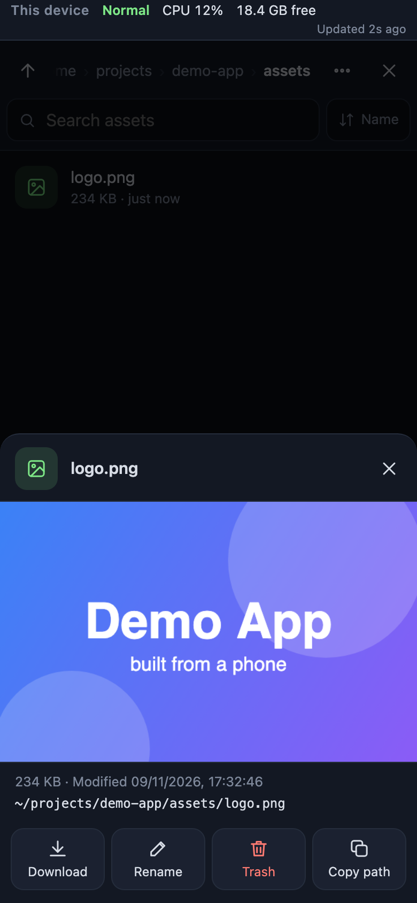<br><sub>Preview a file</sub></td></tr></table>

Browse the folders you allow (your home folder by default), upload several files with progress (2 GB each, never overwriting), download or zip, rename, search by name, and move to the Trash or Recycle Bin. Previews cover images, video, audio, PDF and text, in a sandbox. Every path is checked again after symlinks resolve.

### Git

<table><tr><td align="center" valign="top">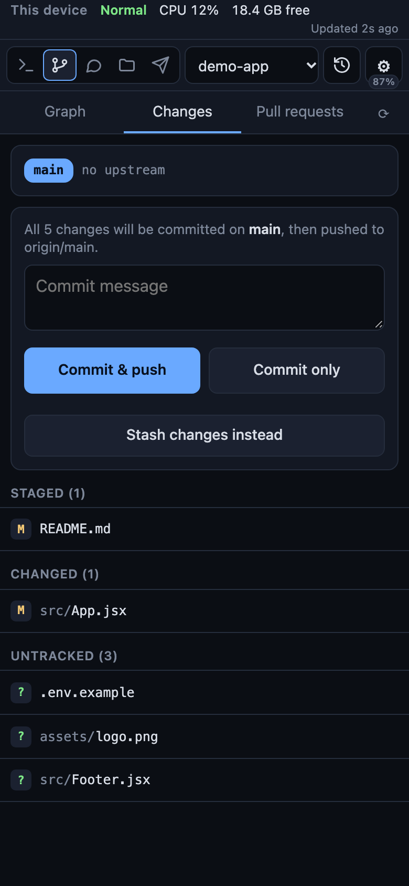<br><sub>Changes, commit and push</sub></td><td align="center" valign="top">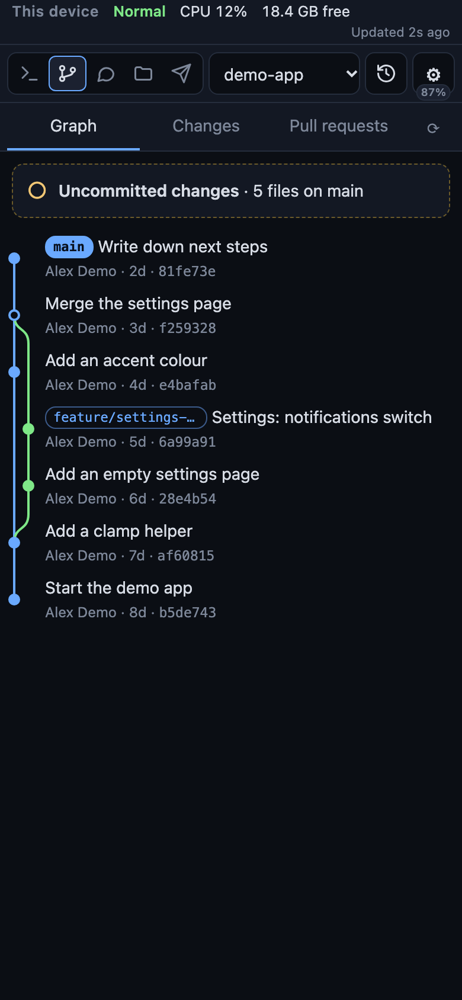<br><sub>History graph</sub></td></tr></table>

A commit graph of all branches, per-file diffs, and a Changes tab that commits everything with your message and pushes (never forcing). Switch and create branches, stash and apply stashes, and work with GitHub pull requests: review, merge, close, reopen and create (through `gh`).

The repository list holds the repositories found under `repoRoots`. To open another one, choose **Open folder…** at the end of the list and pick any folder inside it. Every Chat and Terminal page also has a Git graph button that opens the Graph for that chat's or terminal's folder. Opened repositories stay in the list.

### Chat with Claude Code and Codex

<table><tr><td align="center" valign="top">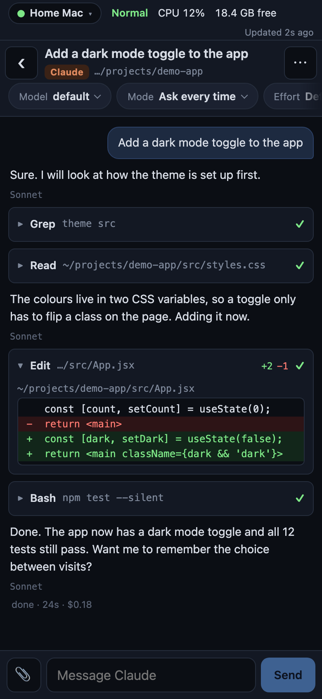<br><sub>Chat with approval cards</sub></td><td align="center" valign="top">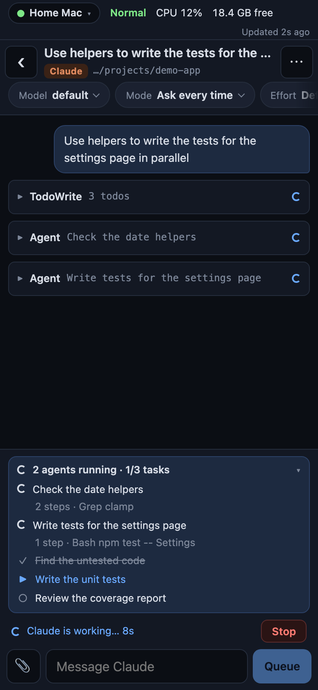<br><sub>Agents panel</sub></td></tr></table>

Start or continue Claude Code and Codex conversations from the phone, with your existing logins. Approval cards (**Allow once**, **Always allow in this chat**, **Deny**), permission modes, a message queue, limits notices and a Copy button are built in. New in 1.1: an agents panel in the chat. You can also resume any conversation from the terminal and take it over from the Mac with `pocket-dev takeover`.

### Messages

<table><tr><td align="center" valign="top">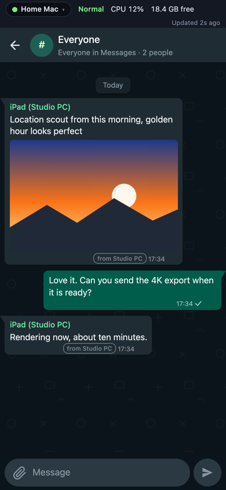<br><sub>WhatsApp-style messages</sub></td></tr></table>

A WhatsApp-style chat between your computers, your phones and the people you invite: text, photos, videos and files. Direct and group chats, delete for everyone, hide for me. From a terminal: `pocket-dev message "build finished"`.

### Open apps, health and power

<table><tr><td align="center" valign="top">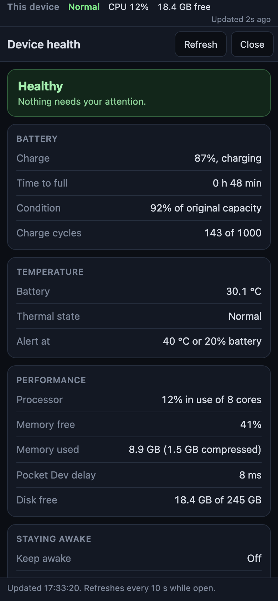<br><sub>Health and alerts</sub></td><td align="center" valign="top">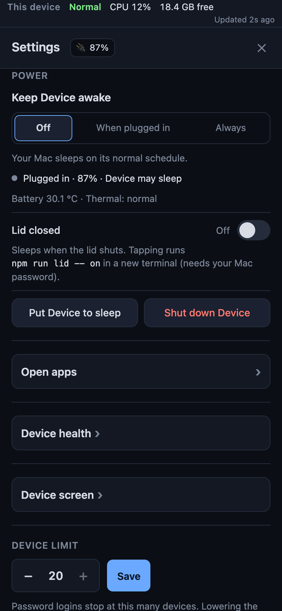<br><sub>Power</sub></td></tr></table>

Open apps lists what is running with memory and CPU and can quit or force quit. The health panel and the strip at the top show battery, temperature, CPU, memory and disk, with alerts when something is off. Power can keep the computer awake (`off`, `plugged`, `always`), put it to sleep or shut it down. **Screen view** shows a read-only picture of the main display.

### Collaborators and the Admin page

<table><tr><td align="center" valign="top">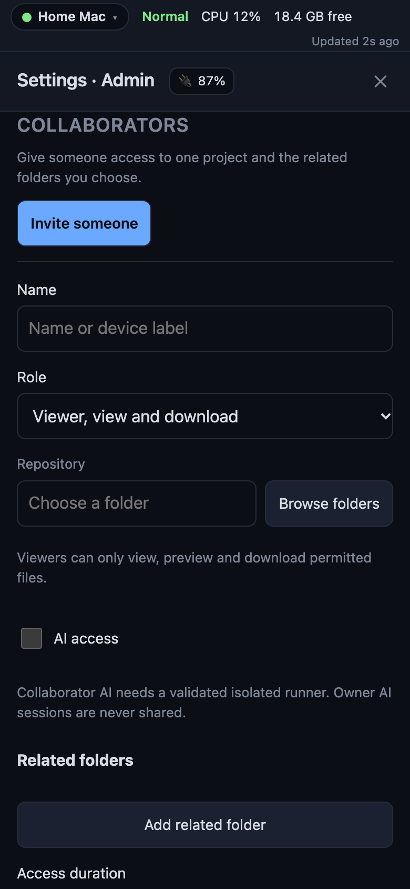<br><sub>One-project access with expiry</sub></td><td align="center" valign="top">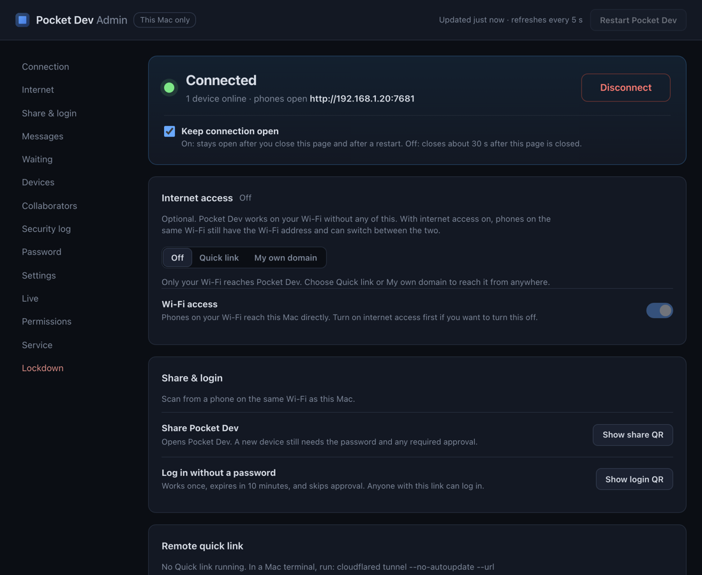<br><sub>Admin page (computer only)</sub></td></tr></table>

Share one project with someone for 1 hour, 1 day or 7 days through a QR invitation: a Viewer previews and downloads, a Developer edits a separate copy, and neither can reach your terminals, chats or other folders. The Admin page runs on `http://localhost:7778` and only a process on the computer can open it: devices, security log, internet access, service, lockdown.

## Rooms: several computers, one phone

Install Pocket Dev on each computer. A **room** joins them so the phone can switch between them, share tasks and messages, and approve what other devices do. The room has one host. Each device keeps its own files, terminals and logins, and nothing private is shared unless its owner allows it.

<p align="center">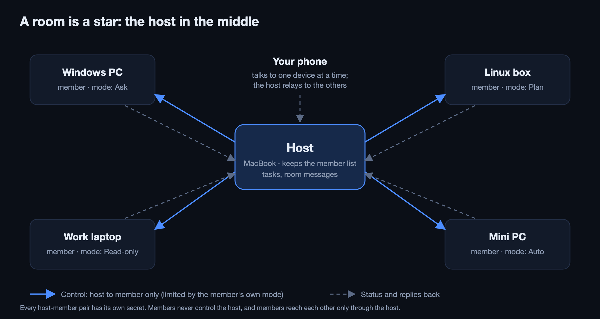</p>

**1. Host a room.** On the computer that will be the host: **Settings, Room**, start a room.

<table><tr><td align="center" valign="top">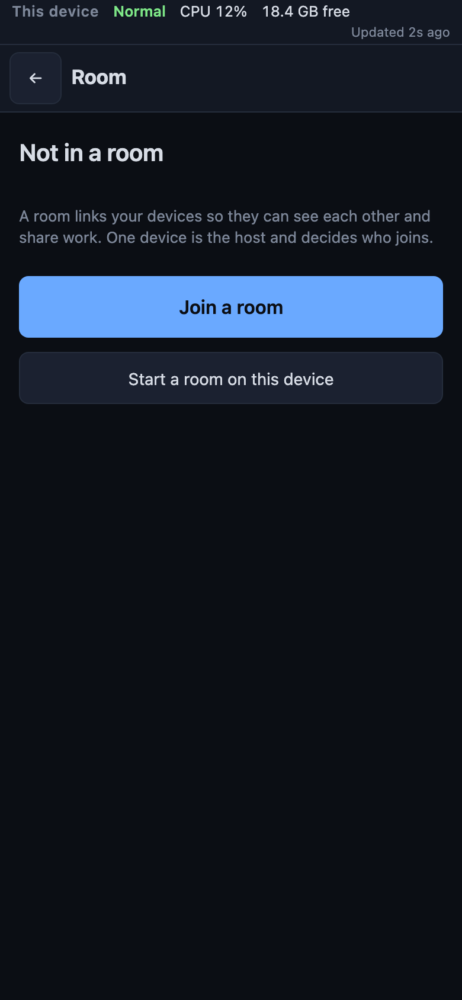<br><sub>Start a room</sub></td><td align="center" valign="top">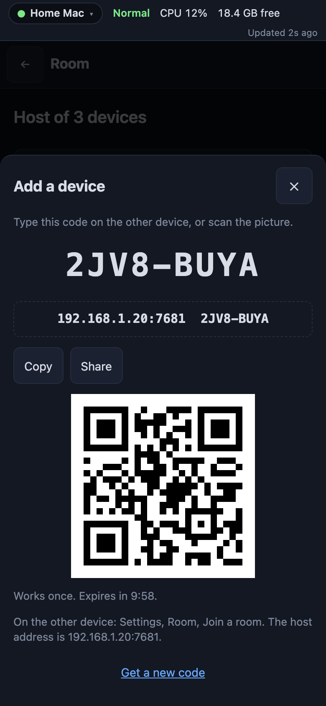<br><sub>Add a device shows a code and QR</sub></td></tr></table>

**2. Add a device.** On the host choose **Add a device**. It shows a short code such as `ABCD-EFGH`, the host's Wi-Fi address and a QR. The code works once, for 10 minutes.

**3. Join.** On the other computer: **Settings, Room, Join a room**. Join any of three ways: paste the invite line or type the address and code, **scan the QR with the camera**, or **choose a photo of the QR**. Then pick what the room may do on this device: **Admin** (everything) or **Collaborator** (chosen folders only).

<p align="center">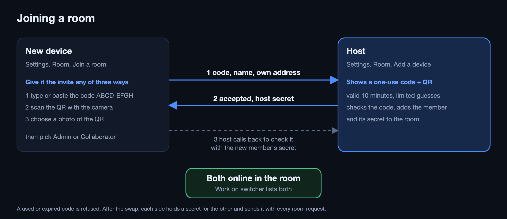</p>

<table><tr><td align="center" valign="top">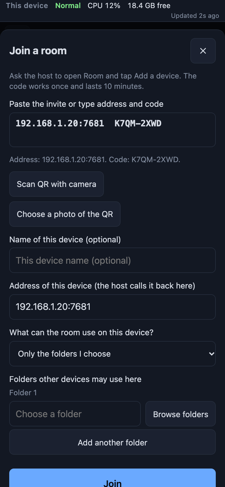<br><sub>Join by code, camera or photo</sub></td><td align="center" valign="top">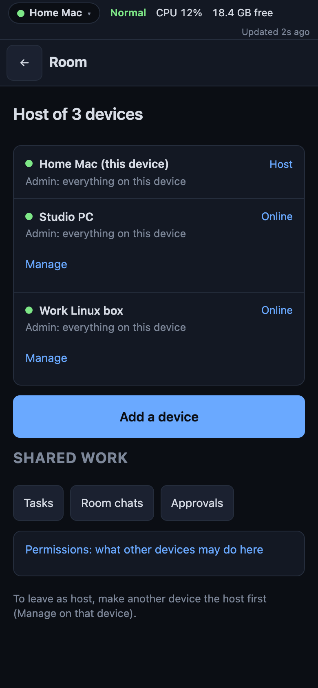<br><sub>Members and who is online</sub></td></tr></table>

**4. Switch.** Tap the **Work on** switcher (the device name in the top strip) to open another device's Files, Terminal, Git, Chat and Messages through the host. Offline devices are marked and say why.

<p align="center">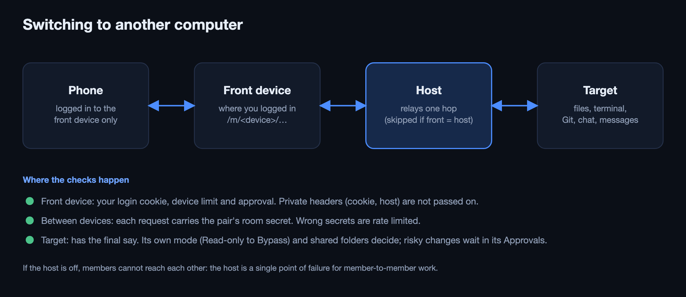</p>

<table><tr><td align="center" valign="top">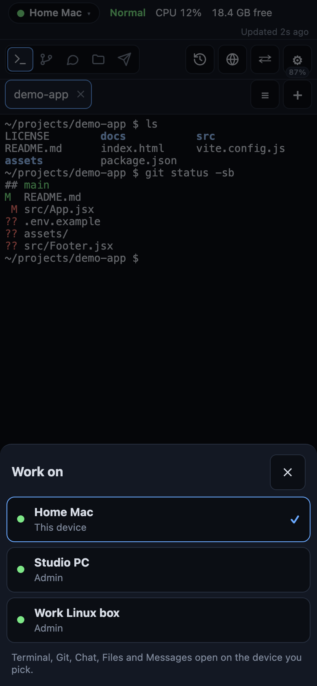<br><sub>Work on another device</sub></td><td align="center" valign="top">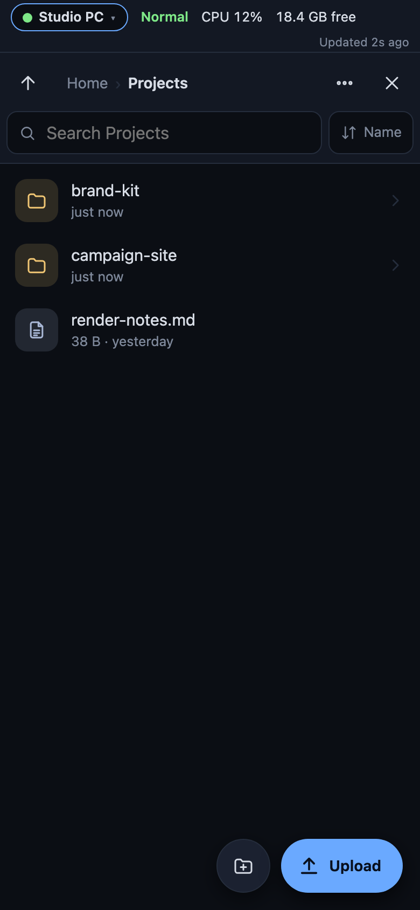<br><sub>Files of a remote computer</sub></td></tr></table>

**5. Tasks, messages and chats.** A simple board with ids like `LAP-14` (To do, Doing, Done, assignee) syncs between devices and catches up after a device was off. Messages to everyone and AI chats from admin-level devices are copied to the others as read-only mirrors (Room chats).

<table><tr><td align="center" valign="top">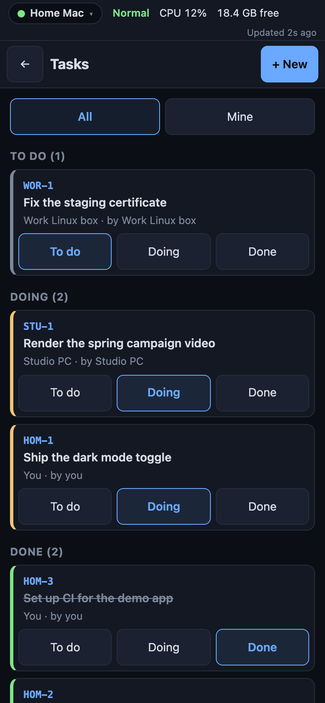<br><sub>Shared tasks</sub></td><td align="center" valign="top">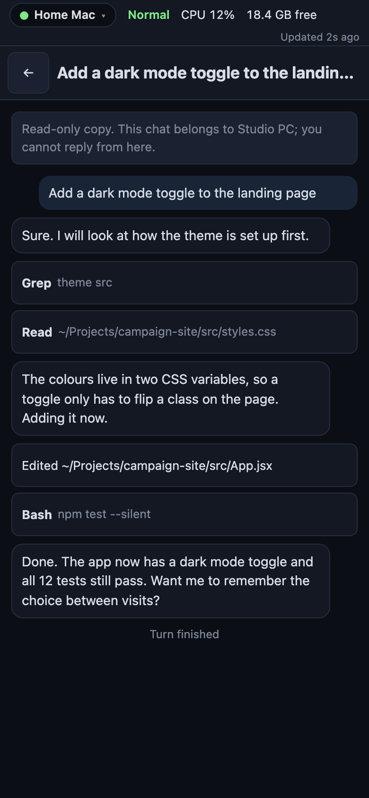<br><sub>Room chats</sub></td><td align="center" valign="top">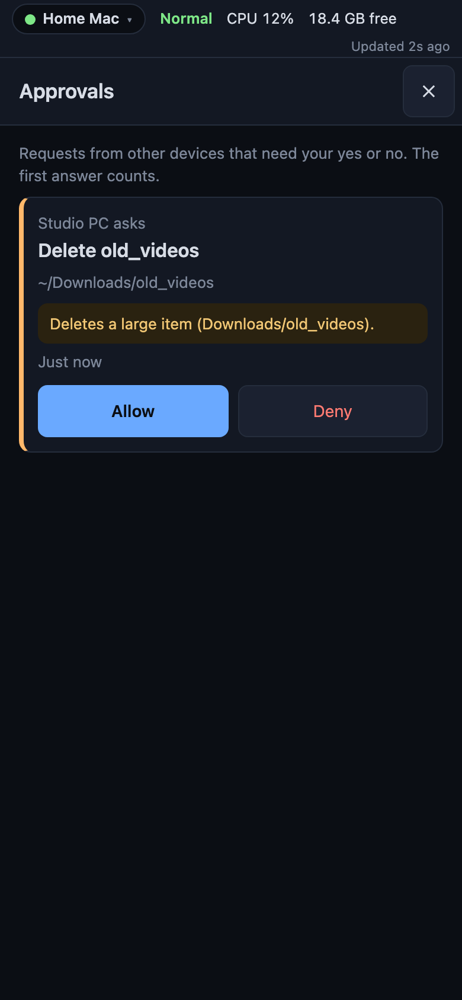<br><sub>Approvals inbox</sub></td></tr></table>

**6. Modes per device.** For each other device you choose Read-only, Plan, Ask, Auto or Bypass. The device's own owner sets it, and risky actions (deleting a folder, running unknown programs, anything outside the shared folders) ask first, except in Bypass. Bypass lasts 1, 2, 3 or 4 hours or Always, shows a red banner on the device, and only that device's owner can turn it on.

<p align="center">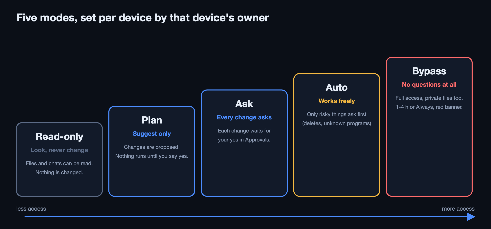</p>

<table><tr><td align="center" valign="top">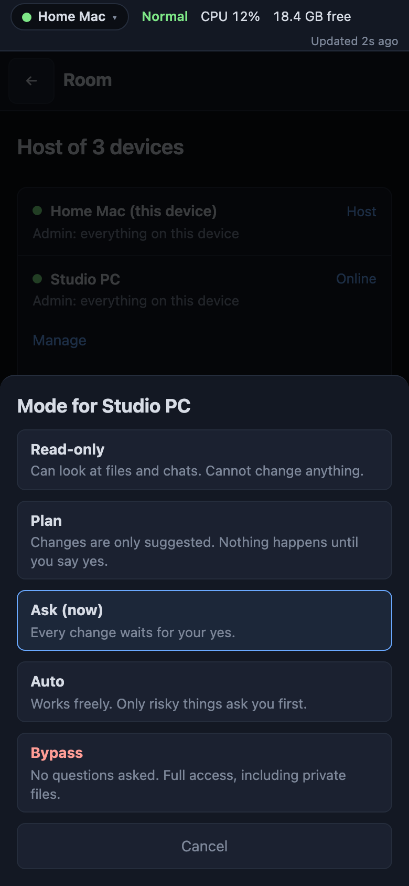<br><sub>Per-device modes</sub></td><td align="center" valign="top">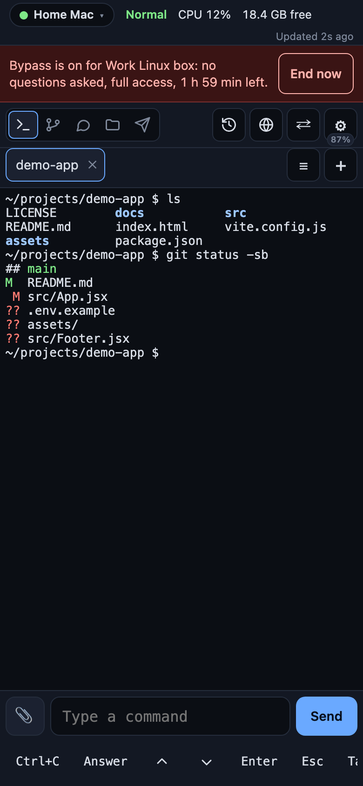<br><sub>Bypass banner</sub></td></tr></table>

**7. Approve.** Requests that need a yes wait in the **Approvals** inbox on the device concerned. The first answer wins.

**8. Leave.** A member can leave at any time. Being removed or leaving ends access at once and removes the room's data from that device.

What the room does not do yet: it is a star, so devices reach each other through the host, and when the host is off the members cannot reach each other. There is no automatic failover and no room over the internet. Messages are not direct between members. Modes are pattern based. Copies of chats follow the owner's admin setting, not per-chat rules. See [the details](REFERENCE.md#rooms-in-detail).

## Use it away from home

Pocket Dev works on your Wi-Fi with none of this. Internet access adds a second address through a [Cloudflare Tunnel](https://developers.cloudflare.com/cloudflare-one/connections/connect-networks/) that `cloudflared` on the computer opens outward, so the router needs no port forwarding and the phone gets https. Only the computer itself can turn it on (Admin page, **Internet access**, or `pocket-dev internet`); a phone can only turn it off. Install the connector once (`brew install cloudflared` on macOS), then choose:

| Choice | Needs | What you get |
| --- | --- | --- |
| **Off** (default) | nothing | Wi-Fi only. |
| **Quick link** | `cloudflared` | A random `https://….trycloudflare.com` address that lasts until you turn it off or Pocket Dev restarts. No account. |
| **My own domain** | `cloudflared`, a free Cloudflare account, a domain on Cloudflare DNS | A fixed `https://pocket.example.com` that stays. |

```sh
pocket-dev internet status          # show it
pocket-dev internet quick           # allow a Quick link, then Turn on in Admin
pbpaste | pocket-dev internet domain --hostname pocket.example.com --token-stdin
pocket-dev internet off
```

Link the phone while it is at home (the phone offers **Link this phone**), because each address has its own login cookie. Afterwards **Settings, Connection** shows both addresses with **Switch to local** and **Switch to remote**. Nothing switches by itself. The full steps (tunnel token, HTTPS, linking, Wi-Fi access off) are in [docs/REFERENCE.md](REFERENCE.md#internet-access-in-detail).

## Security model

- **Wi-Fi is plain http.** Anyone who can read the traffic on that network can see the cookie and terminal contents. Use a trusted network. Through the optional internet link the phone talks https to Cloudflare, which can read the traffic it relays.
- **A logged-in device has the full rights of your user:** shell, files, and your Claude, Codex and GitHub logins (limited by the credentials and permissions you configured).
- **Port 7777 listens on all interfaces** (`0.0.0.0`), or on the computer itself only with Wi-Fi access off. Forwarded ports listen on the LAN IP and have no password.
- **Protections:** hashed password (scrypt) and cookies, one-time QR keys only from the computer, a device limit, a `SameSite=Strict` HttpOnly cookie, the `x-pocket-dev` header and JSON content-type for every change, a WebSocket `Origin` check, a Git repository allowlist, path checks after symlink resolution, sandboxed previews, and typed Messages attachments (only PNG, JPEG, GIF, WebP, MP4, WebM, MOV, MP3, M4A, Ogg and WAV display; everything else downloads, with `nosniff` and a sandbox policy).
- **Admin page:** `127.0.0.1:7778`, with a Host allowlist that resists DNS rebinding. It has no password, so any local process can use it.
- **Rooms:** a device joins only with a one-time short code (10 minutes, limited guesses). The host's control of a member is limited by the member's own mode, and a member never controls the host. Every room request carries a secret per device, failed secrets are rate limited, and kicking or leaving closes open connections. The host is a single point of failure for member-to-member work.
- **Not protected:** traffic sniffing on the LAN, forwarded ports, an unlocked logged-in phone, local processes on the computer, or a malicious program on it. The login throttles wrong passwords (10 per IP in 15 minutes, then a 15-minute lock).

Full table (cookies, CSRF, approval, block, lockdown, security log): [docs/REFERENCE.md](REFERENCE.md#collaborators-login-and-security).

## Commands

| Command | What it does |
| --- | --- |
| `pocket-dev start [--port N] [--admin-port N] [--no-open]` | Run the server in this terminal. The flags override `config.json` for this run. |
| `pocket-dev config list` | Show every setting and the file it is saved in. The password hash shows as `<set>`. |
| `pocket-dev config get <key>` | Show one setting. |
| `pocket-dev config set <key> <value>` | Change a setting. The value is checked first, and a bad value changes nothing. |
| `pocket-dev config unset <key>` | Go back to the default. |
| `pocket-dev config path` | Print the config file path. |
| `pocket-dev service install\|restart\|uninstall\|status\|logs` | Run it in the background (launchd, macOS), or manage that. |
| `pocket-dev service autostart on\|off\|status` | Start at login or not (macOS). |
| `pocket-dev takeover <id>\|--last` | Close Pocket Dev's copy of a conversation, then continue it in this terminal with `claude --resume` or `codex resume`. |
| `pocket-dev internet status\|off\|quick` | Show internet access and the link's status, turn it off, or allow a Quick link. |
| `pocket-dev internet domain --hostname <host> --token-stdin` | Use your own domain through a Cloudflare tunnel. The token comes from stdin, or from a file with `--token-file <path>`, never as an argument. |
| `pocket-dev qr [--link <address>]`, `admin`, `connect`, `disconnect`, `awake` | Print a one-time login QR (for an internet address with `--link`), open the Admin page, turn phone access on or off, set Keep awake (`on\|plugged\|off\|status`). |
| `pocket-dev message [text] [--to NAME] [--file PATH]` | Send to Messages as this computer. Text comes from the argument or piped stdin. |
| `pocket-dev version`, `pocket-dev help` | Show the version, or the command list. |

## Configuration

`config.json` lives in `~/.pocket-dev/` (or `POCKET_DEV_STATE_DIR`, or exactly at `POCKET_DEV_CONFIG`; on Windows `%USERPROFILE%\.pocket-dev`). Edit it by hand or with `pocket-dev config`. `config set` accepts `port`, `adminPort`, `awake`, `requireApproval`, `approveFromDevices`, `maxDevices`, `chatIdleMinutes`, `batteryAlertPercent`, `temperatureAlertC`, `screenView`, `allowedHosts` (comma separated), `messagesReserveGB` and `greeting`. `port` and `adminPort` apply after a restart; the rest apply right away. Change the password on the Admin page (`pocket-dev admin`). Pocket Dev rereads the file at use, so you can edit it while the server runs.

| Key | Default | Meaning |
| --- | --- | --- |
| `port` | `7777` | Phone port. `PORT` overrides it. |
| `passwordHash` | generated | scrypt hash of the password. |
| `password` | none | Plaintext password to migrate. Converted to `passwordHash` at start. |
| `maxDevices` | `2` | Device limit, 1 to 20. |
| `folders` | `[]` | Pinned folders (terminal picker and Files). |
| `recentFolders` | `[]` | Last 5 terminal folders. |
| `shortcuts` | `claude`, `codex`, `npm run dev`, `git status`, `git pull` | Shortcut commands. |
| `repoRoots` | `~/Desktop`, `~/Desktop/Projects`, `~` | Git scan roots. `POCKET_DEV_REPO_ROOTS` (colon-separated) overrides it. |
| `gitRepos` | saved by Git | Repositories opened by hand (**Open folder…**, or the Git graph button on a chat or terminal), newest first, at most 20. |
| `awake` | `plugged` | Keep awake mode: `off`, `plugged`, or `always`. |
| `allowedHosts` | `[]` | Additional hostnames accepted by the phone listener. |
| `greeting` | `personal` | The note at the end of setup. `plain` leaves out your first name, the system and the time of day. It is made on the computer and never sent. |
| `chatDefaults` | saved by Chat | Last safe tool, folder, model, mode, and effort choices. Bypass and Full access are never silently remembered. |
| `chatIdleMinutes` | `10` | Idle minutes before a chat engine stops. |
| `batteryAlertPercent` | `20` | Alert when the battery is at or below this percent and not charging, 5 to 90. |
| `temperatureAlertC` | `40` | Alert when the battery temperature reaches this many °C, 30 to 70. |
| `messagesReserveGB` | `5` | While less than this is free, Messages files over 50 MB wait. 0 to 1000. |
| `screenView` | `true` | Whether a logged-in phone may see the computer's screen. `false` refuses with 403. |
| `requireApproval` | `false` | New devices wait for approval on the computer. |
| `approveFromDevices` | `false` | A logged-in owner phone may approve or deny waiting logins. Only the computer turns it on. |
| `fileRoots` | home folder | Folders Files may show. |
| `fileUploadMax` | 2 GiB | Files upload limit in bytes. |
| `fileZipMax` | 4 GiB | Zip limit in bytes, before compression. |
| `adminPort` | phone port + 1 (`7778`) | Admin page port. `POCKET_DEV_ADMIN_PORT` overrides it. |
| `access` | `{"connected": true, "keepOpen": true}` | Phone access and Keep connection open. |
| `network` | `{"wifi": true, "internet": {"kind": "off"}}` | Wi-Fi access and the kind of [internet access](#use-it-away-from-home): `off`, `quick`, or `domain` with a `hostname`. `wifi: false` applies after a restart and is refused while internet is off. |

Environment variables: `PORT`, `POCKET_DEV_CONFIG`, `POCKET_DEV_PASSWORD` (overrides the stored password and is printed at start), `POCKET_DEV_REPO_ROOTS`, `POCKET_DEV_STATE_DIR`, `POCKET_DEV_CHAT_DIR`, `POCKET_DEV_ADMIN_PORT`, `POCKET_DEV_NO_OPEN`, `POCKET_DEV_CLOUDFLARED`, and for Codex `POCKET_DEV_CODEX_SOCKET` and `POCKET_DEV_CODEX`. See [docs/REFERENCE.md](REFERENCE.md#environment-variables).

### Permissions it needs

Pocket Dev runs as your user, never as root, and never runs `sudo` itself.

| Permission | Needed for |
| --- | --- |
| Firewall: incoming connections for `node` | The phone can connect (only when the firewall is on). Windows: choose Private networks. |
| macOS Automation: control **System Events** | Normal shutdown, window names in Open apps. |
| macOS Accessibility | Window names in Open apps. |
| macOS Screen Recording | Screen view (without it the picture shows only the wallpaper). |
| macOS Full Disk Access (maybe) | Files, for protected folders. |
| Your `claude`, `codex`, and `gh` logins | Chat, terminals, Git. |
| Your computer password, typed by you in a terminal | Lid closed, sleep with Lid closed on, force shutdown (macOS). |

The Admin page has a **Permissions** panel that shows each of these. Details: [docs/REFERENCE.md](REFERENCE.md#permissions-it-needs).

## Troubleshooting

**The phone cannot open the address.** Check that the phone is on the same Wi-Fi (not mobile data, not a guest network that isolates devices), that the address is the computer's Wi-Fi address (`ipconfig getifaddr en0`, `ipconfig`, `hostname -I`), and that Pocket Dev is running (`pocket-dev start` shows the URL). Plain `localhost` only works on the computer itself. Some Android phones cannot open `.local` names: use the numeric address.

**Firewall.** Windows: when the prompt appeared you must choose **Private networks**. If you dismissed it, open Windows Defender Firewall, Allow an app, and allow Node.js on Private. macOS: allow incoming connections for `node`. Linux: allow TCP 7777 from your network.

**`pocket-dev doctor`.** Run it on the computer where Pocket Dev is installed. It prints a table of ticks and crosses (Node version, how Pocket Dev was installed, npm's global folder on PATH, the `pocket-dev` command, terminals, Git/Claude Code/Codex/GitHub CLI/cloudflared, the settings folder, port 7777, with a tick when this Pocket Dev holds it) with the exact next command for each cross. When Pocket Dev is running it also reminds you to restart it after installing a tool, because a running copy keeps the PATH it started with. It exits 0 when everything required works and 1 otherwise. `pocket-dev doctor --fix` repairs terminals after showing the command and asking `[Y/n]` (`--yes` skips the question); it never uses `sudo`.

**`pocket-dev` is not recognized / command not found.** You skipped `-g`, or the terminal was opened before the install. Open a new terminal and run `npm config get prefix` to see where npm puts global commands; that folder (or its `bin`) must be on your PATH. `pocket-dev doctor` shows that folder and the command that adds it; if the command itself is missing, run `npx -y @anisirji/pocket-dev doctor` instead.

**Terminals are not available on this computer.** `node-pty`, the part that runs shells, is an optional dependency: if npm cannot download or build it, the install still succeeds and Pocket Dev starts with everything except terminals. The phone's Terminal view then shows a card with the repair command. Run **`pocket-dev doctor --fix`** on the computer, then restart Pocket Dev. If the repair reports a missing compiler: macOS `xcode-select --install`; Windows Visual Studio Build Tools (C++ workload) and Python 3; Linux `sudo apt install build-essential python3`.

**Windows: ENOENT / TAR_ENTRY_ERROR / spawn cmd.exe ... node-pty.** npm lost files while unpacking (antivirus or a bad cache; installs from GitHub make it likelier). In PowerShell:

1. Remove the half-installed folder: `Remove-Item -Recurse -Force "$env:APPDATA\npm\node_modules\@anisirji"`
2. `npm cache clean --force`
3. Retry with the scoped name (not `anisirji/pocket-dev`, which installs from GitHub) and see the real error: `npm install -g @anisirji/pocket-dev --foreground-scripts`. A failing `node-pty` no longer fails the install.
   Then run `pocket-dev doctor --fix` to add the terminals back.
4. Pause real-time antivirus for the install, or add an exclusion for the npm folders (`%APPDATA%\npm` and `%LOCALAPPDATA%\npm-cache`).
5. If `node-pty` has to build, install Visual Studio Build Tools (C++ workload) and Python 3, then retry.
6. If it still fails, run it without installing: `npx -y @anisirji/pocket-dev start`.

**`node-pty` fails to build.** macOS: `xcode-select --install`. Windows: Visual Studio Build Tools with the C++ workload and Python 3. Linux: `build-essential` and Python 3. A prebuilt binary is used first when one exists.

**Port 7777 is in use.** `pocket-dev doctor` shows a tick when the program on it is this Pocket Dev, and then nothing is wrong: `pocket-dev start` says it already runs and prints the address and a QR code. Otherwise another program (or an older Pocket Dev) has it, and the doctor suggests a free port that is never 7778 (the Admin page). Use `pocket-dev start --port 7780`, or `pocket-dev config set port 7780` and restart. On macOS `pocket-dev service install --force` takes over the port from a stray copy.

**I forgot the password.** Run `pocket-dev admin` on the computer and set a new one under **Password** (no old password needed). Or start once with `POCKET_DEV_PASSWORD=<new>` (PowerShell: `$env:POCKET_DEV_PASSWORD='<new>'`), which overrides the stored one.

**Device limit.** `maxDevices` defaults to 2: a third password login is refused. Log an old device out on the Admin page (**Devices**), or raise it: `pocket-dev config set maxDevices 5`. A QR login evicts the least recently used device instead.

**The room invite shows 127.0.0.1 or no address.** Another device can never use `localhost` or `127.0.0.1`. The host has no Wi-Fi/LAN address: connect it to the network, reload, and make a new code. If you opened the host page as `localhost`, open it by its Wi-Fi address instead.

**The Sleep button on Windows.** Do not use it remotely unless you know that PC wakes: it may hibernate, and nothing remote can wake it. This is true for any system: Pocket Dev cannot wake a computer.

**Screen view shows only the wallpaper (macOS).** Allow Screen Recording for the program that runs Pocket Dev (Terminal, VS Code, or `node` for the service). The Admin page's Permissions panel opens the right page.

## Limitations

- No passkeys yet. Internet access needs `cloudflared` and, for a fixed address, a Cloudflare account and a domain on Cloudflare DNS.
- Terminals and port forwards do not survive a computer restart.
- Old uploads in `~/.pocket-dev/uploads` are never deleted.
- Agent services such as Claude and Codex still need internet access on the computer.
- Pocket Dev cannot wake or power on any device, and the remote Sleep button can leave a device unreachable until someone presses its power button.
- Rooms work over the Wi-Fi or each device's own address. Failover across devices and a room over the internet are not built, and a device that is asleep or off leaves the room until it wakes.
- Files over the internet connector are limited to 100 MB in Messages (a Cloudflare free-plan limit).
- Windows: main features tested on a real PC; temperature, lid control and window names are unavailable. Linux: written and partly tested, not run on a real machine. `pocket-dev service` uses launchd on macOS and the Task Scheduler on Windows (tested on a real PC), and systemd on Linux (not run on a real machine).
- Upcoming, not built: Google Antigravity CLI in the terminal and in Chat, passkeys and fingerprint login, an Android share target. See [the roadmap](ROADMAP.md).

## Develop and test

From a clone of the repository:

```sh
npm install
npm start          # run in the foreground
npm test           # node --test test/*.test.mjs
```

Pocket Dev has no npm install scripts, so an install cannot fail on one; node-pty 1.1.0 ships its `spawn-helper` without the execute bit and `pty-loader.js` fixes that when it loads node-pty. The first start writes `~/.pocket-dev/config.json` (mode 0600) and prints the password once, a login QR and the URL. Other `npm run` scripts (`qr`, `admin`, `connect`, `disconnect`, `awake`, `lid`, `sleep`, `shutdown`, `service:*`, `autostart`) are listed in [docs/REFERENCE.md](REFERENCE.md#commands). To try a build as a package: `npm pack`, then `npm install -g ./anisirji-pocket-dev-*.tgz`; or `npm link` to use your working copy as `pocket-dev`.

The suite starts disposable phone and Admin listeners, uses fixture folders, stubbed power commands and a stand-in for `cloudflared`, and exercises authentication, Host/Origin/CSRF checks, terminals, chat persistence, Files, devices, lockdown, the tunnel kinds, rooms and modes. It makes no model calls, opens no real tunnel, and does not install a service or quit user apps.

Before publishing, run `node tools/set-image-version.mjs` so the README's screenshot links point at the version being published (`node tools/set-image-version.mjs --restore` puts the `__VERSION__` token back).

## Licence

ISC. See [LICENSE](../LICENSE).
